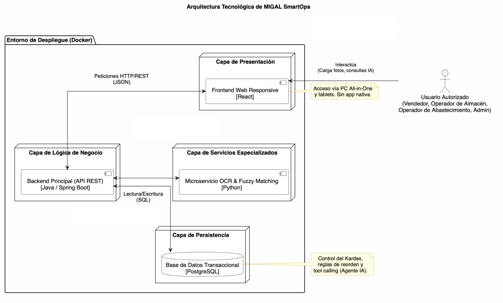

# Arquitectura Tecnológica de MIGAL SmartOps (Tech Stack)

La plataforma MIGAL SmartOps está diseñada bajo una arquitectura moderna orientada a servicios (SOA), estructurada en capas independientes que se comunican a través de protocolos estándar. Esta separación garantiza la mantenibilidad, escalabilidad y el cumplimiento de los requerimientos no funcionales definidos para el proyecto.

La arquitectura se divide en los siguientes componentes principales:

## 1. Capa de Presentación (Frontend - React)

- La interfaz de usuario se construirá como una aplicación web responsive optimizada para navegadores de escritorio (PC All-in-One) y tablets del mostrador.

- Se utilizará la librería React para desarrollar una Single Page Application (SPA) que gestione la autenticación basada en roles (Administrador, Vendedor, Almacenero y Reponedor).

- El frontend incluirá un componente visual interactivo (drag-and-drop) para la carga manual de fotografías y archivos de documentos operativos en formatos JPG, PNG o PDF, incluyendo solicitudes o pedidos de clientes y documentos utilizados durante la recepción de mercadería.

- Esta capa alojará la interfaz conversacional del Agente de IA, permitiendo a los usuarios realizar consultas en lenguaje natural directamente desde el navegador.

## 2. Capa de Lógica de Negocio (Backend Principal - Java / Spring Boot)

- El núcleo transaccional del sistema operará sobre Java utilizando el framework Spring Boot.

- Este backend expondrá una API REST que gestionará todas las reglas del Kardex de existencias físicas, sincronizando las existencias entre la tienda principal y los dos almacenes físicos.

- Será el responsable de procesar los movimientos de inventario (entradas, salidas) de manera transaccional, calcular el punto de reorden determinista y exponer la información hacia la interfaz web y el agente de IA.

- Además, integrará el mecanismo de tool calling para que el agente consultivo de IA pueda invocar funciones seguras del backend sin modificar directamente los datos.

- Asimismo, el backend gestionará la lógica asociada a cotizaciones, ventas, órdenes de compra y recepciones, manteniendo la trazabilidad entre dichas operaciones y los movimientos de inventario cuando corresponda.

## 3. Capa de Servicios Especializados y Visión (Microservicio - Python)

- Los componentes que requieran procesamiento pesado de imágenes o algoritmos matemáticos complejos se desacoplarán del backend principal mediante un microservicio escrito en Python.

- Este servicio ejecutará el motor de Extracción Óptica de Caracteres (OCR) para segmentar e interpretar el texto no estructurado de los documentos operativos cargados por los usuarios, incluyendo solicitudes o pedidos de clientes y documentos utilizados durante la recepción de mercadería.

- Incluirá el algoritmo de lógica difusa (Fuzzy Matching), que comparará el texto extraído —como jergas, abreviaturas o denominaciones comerciales utilizadas por clientes y proveedores— con el catálogo maestro de la ferretería, calculando niveles de similitud para sugerir el SKU oficial correspondiente.

## 4. Capa de Persistencia de Datos (Base de Datos - PostgreSQL)

- El almacenamiento transaccional se gestionará mediante un motor de base de datos relacional PostgreSQL.

- Almacenará de forma normalizada el catálogo maestro de productos, la configuración física de la tienda y los almacenes, y el control de existencias físicas en tiempo real. Asimismo, contendrá los registros de proveedores y sus relaciones con los productos, así como los datos referenciales de clientes asociados a cotizaciones y ventas. Finalmente, gestionará la información transaccional correspondiente a cotizaciones, ventas, órdenes de compra, recepciones y movimientos de inventario.

## 5. Infraestructura y Despliegue (Docker)

- Para garantizar la reproducibilidad y aislar las dependencias del entorno (especialmente las librerías de visión artificial en Python y el entorno de ejecución Java), todos los componentes se empaquetarán y desplegarán utilizando contenedores Docker.

## 6. Diagrama de arquitectura tecnológica

