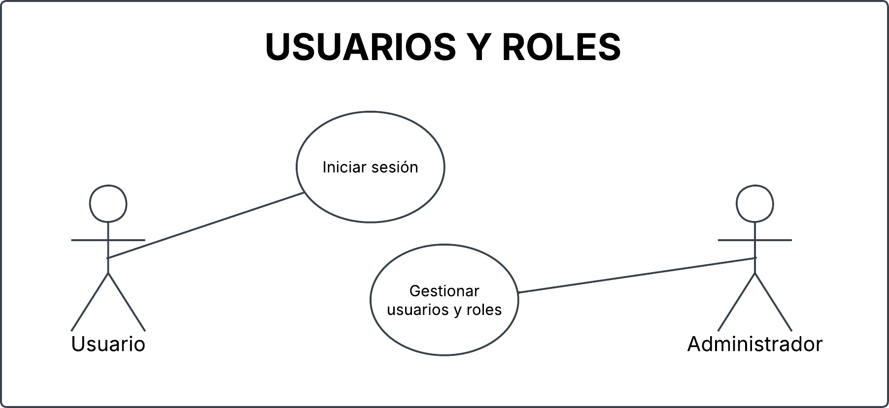
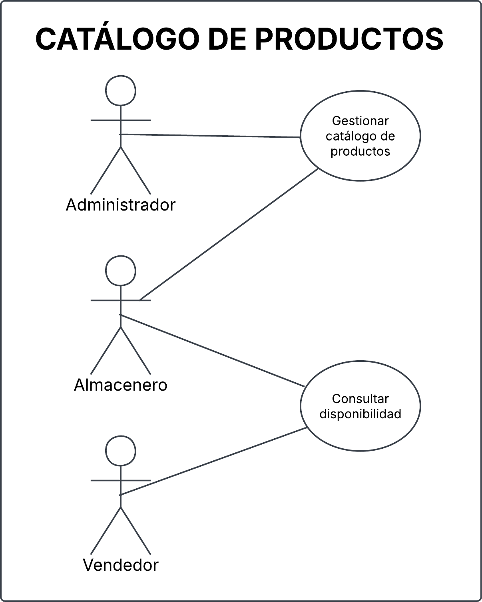
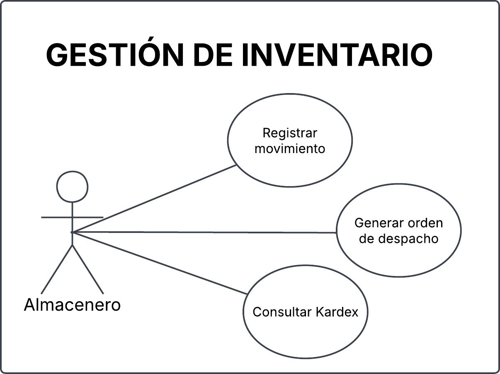
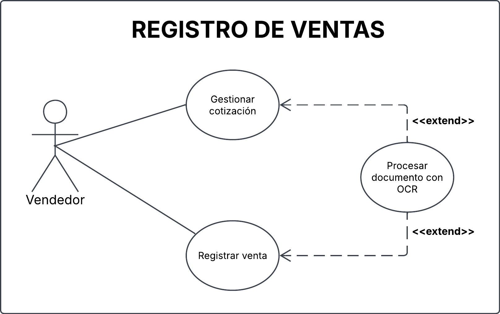
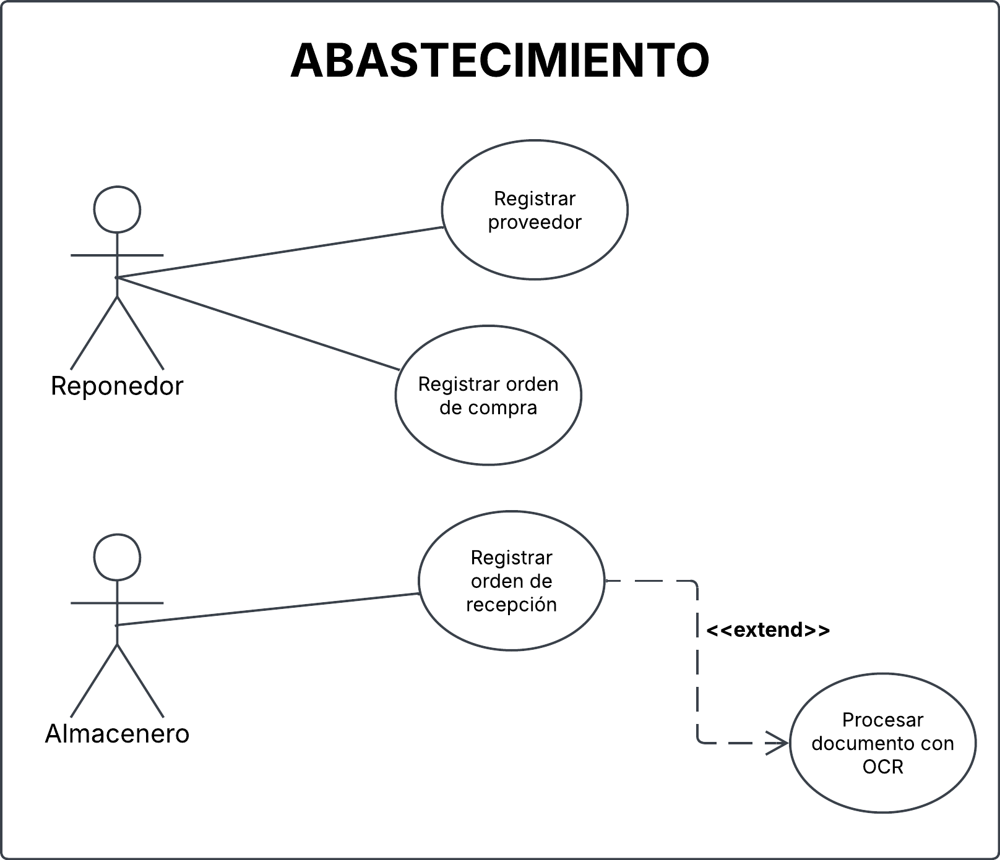
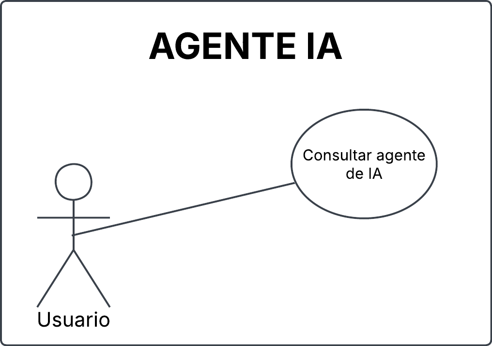

# Casos de uso

Este documento presenta el catálogo de casos de uso de MIGAL SmartOps y sus diagramas UML organizados por módulo.

Las especificaciones completas se encuentran en [Especificaciones de casos de uso](especificaciones-casos-de-uso.md).

## Catálogo

| Código | Nombre | Referencia |
| --- | --- | --- |
| CU-01 | Iniciar sesión | [Especificación](especificaciones-casos-de-uso.md#cu-01) |
| CU-02 | Gestionar usuarios y roles | [Especificación](especificaciones-casos-de-uso.md#cu-02) |
| CU-03 | Gestionar catálogo de productos | [Especificación](especificaciones-casos-de-uso.md#cu-03) |
| CU-04 | Consultar disponibilidad | [Especificación](especificaciones-casos-de-uso.md#cu-04) |
| CU-05 | Registrar movimiento | [Especificación](especificaciones-casos-de-uso.md#cu-05) |
| CU-06 | Generar orden de despacho | [Especificación](especificaciones-casos-de-uso.md#cu-06) |
| CU-07 | Consultar Kardex | [Especificación](especificaciones-casos-de-uso.md#cu-07) |
| CU-08 | Procesar documento con OCR | [Especificación](especificaciones-casos-de-uso.md#cu-08) |
| CU-09 | Gestionar cotización | [Especificación](especificaciones-casos-de-uso.md#cu-09) |
| CU-10 | Registrar venta | [Especificación](especificaciones-casos-de-uso.md#cu-10) |
| CU-11 | Registrar proveedor | [Especificación](especificaciones-casos-de-uso.md#cu-11) |
| CU-12 | Registrar orden de compra | [Especificación](especificaciones-casos-de-uso.md#cu-12) |
| CU-13 | Registrar orden de recepción | [Especificación](especificaciones-casos-de-uso.md#cu-13) |
| CU-14 | Consultar agente de IA | [Especificación](especificaciones-casos-de-uso.md#cu-14) |

## Diagramas por módulo

### 1. Gestión de usuarios y roles

El diagrama comprende los siguientes casos de uso:

- **CU-01:** Iniciar sesión.
- **CU-02:** Gestionar usuarios y roles.

### 2. Catálogo de productos

El diagrama comprende los siguientes casos de uso:

- **CU-03:** Gestionar catálogo de productos.
- **CU-04:** Consultar disponibilidad.

### 3. Gestión de inventario

El diagrama comprende los siguientes casos de uso:

- **CU-05:** Registrar movimiento.
- **CU-06:** Generar orden de despacho.
- **CU-07:** Consultar Kardex.

### 4. Registro de ventas y gestión de cotizaciones

El diagrama comprende los siguientes casos de uso:

- **CU-08:** Procesar documento con OCR.
- **CU-09:** Gestionar cotización.
- **CU-10:** Registrar venta.

### 5. Abastecimiento

El diagrama comprende los siguientes casos de uso:

- **CU-11:** Registrar proveedor.
- **CU-12:** Registrar orden de compra.
- **CU-13:** Registrar orden de recepción.
- **CU-08:** Procesar documento con OCR, como parte de un flujo alternativo de recepción.

### 6. Consulta con agente de inteligencia artificial

El diagrama comprende el siguiente caso de uso:

- **CU-14:** Consultar agente de IA.