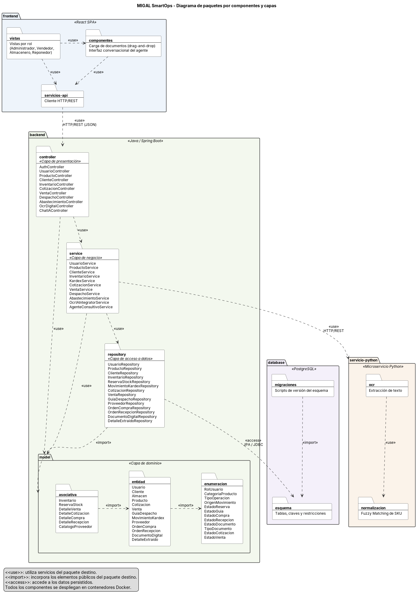

# Diagramas de paquetes

Este documento presenta los diagramas de paquetes de MIGAL SmartOps, que organizan los elementos del sistema en agrupaciones lógicas y muestran las dependencias entre ellas.

Los elementos de cada paquete corresponden a las clases definidas en el [Modelo y diccionario de clases](modelo-y-diccionario-clases.md), y los componentes tecnológicos a la [Arquitectura tecnológica](arquitectura-tecnologica.md).

## Índice

- [PAQ-01: Componentes y capas](#paq-01)
- [Notación](#notacion)

## PAQ-01: Componentes y capas

El diagrama presenta los cuatro componentes de MIGAL SmartOps (`frontend`, `backend`, `servicio-python` y `database`) y, dentro del backend, las capas de presentación, negocio, acceso a datos y dominio.

[Código fuente](fuentes/paquetes/MIGAL-PAQ-01-componentes-y-capas.puml)

| Paquete | Contenido | Depende de |
| --- | --- | --- |
| `frontend` | Vistas por rol, componentes de carga de documentos e interfaz conversacional, y cliente HTTP/REST. | `controller` mediante HTTP/REST. |
| `controller` | Controladores que exponen la API REST y delegan el procesamiento a la capa de negocio. | `service`, `model`. |
| `service` | Servicios con las reglas de negocio, el control transaccional del inventario y la coordinación con el microservicio Python. | `repository`, `model`, `servicio-python`. |
| `repository` | Interfaces de acceso a datos sobre PostgreSQL. | `model`, `database`. |
| `model` | Entidades, clases asociativas y enumeraciones del dominio. | Sin dependencias externas. |
| `servicio-python` | Extracción de texto mediante OCR y normalización mediante Fuzzy Matching. | Ninguno; recibe del backend los documentos y términos que procesa. |
| `database` | Esquema relacional de PostgreSQL y sus migraciones. | Sin dependencias. |

Las dependencias siguen una sola dirección: la presentación utiliza el negocio, el negocio utiliza el acceso a datos y todas las capas comparten el dominio. Ninguna capa inferior depende de una superior, y el frontend no accede directamente a la base de datos ni al microservicio Python.

## Notación

| Estereotipo | Significado |
| --- | --- |
| `<<use>>` | El paquete origen utiliza servicios u operaciones del paquete destino. |
| `<<import>>` | El paquete origen incorpora los elementos públicos del paquete destino. |
| `<<access>>` | El paquete origen accede a los datos persistidos en el paquete destino. |

Los diagramas se mantienen en sintaxis PlantUML dentro de `docs/fuentes/paquetes/`. Para regenerar una imagen se puede utilizar la extensión PlantUML de VS Code o el servidor de [PlantUML](https://www.plantuml.com/plantuml), exportando el PNG a `docs/imagenes/` con el mismo nombre base de la fuente.
