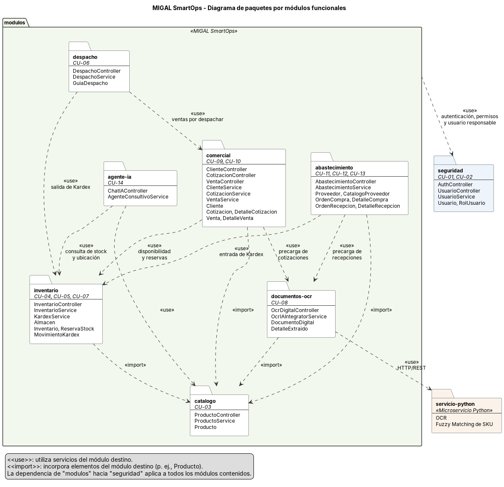

# Diagramas de paquetes

Este documento presenta los diagramas de paquetes de MIGAL SmartOps, que organizan los elementos del sistema en agrupaciones lógicas y muestran las dependencias entre ellas.

Los elementos de cada paquete corresponden a las clases definidas en el [Modelo y diccionario de clases](modelo-y-diccionario-clases.md), y los componentes tecnológicos a la [Arquitectura tecnológica](arquitectura-tecnologica.md).

## Índice

- [PAQ-01: Componentes y capas](#paq-01)
- [PAQ-02: Módulos funcionales](#paq-02)
- [Notación](#notacion)

## PAQ-01: Componentes y capas

El diagrama presenta los cuatro componentes de MIGAL SmartOps (`frontend`, `backend`, `servicio-python` y `database`) y, dentro del backend, las capas de presentación, negocio, acceso a datos y dominio.

[Código fuente](fuentes/paquetes/MIGAL-PAQ-01-componentes-y-capas.puml)

| Paquete | Contenido | Depende de |
| --- | --- | --- |
| `frontend` | Vistas por rol, componentes de carga de documentos e interfaz conversacional, y cliente HTTP/REST. | `controller` mediante HTTP/REST. |
| `controller` | Controladores que exponen la API REST y delegan el procesamiento a la capa de negocio. | `service`, `model`. |
| `service` | Servicios con las reglas de negocio, el control transaccional del inventario y la coordinación con el microservicio Python. | `repository`, `model`, `servicio-python`. |
| `repository` | Interfaces de acceso a datos sobre PostgreSQL. | `model`, `database`. |
| `model` | Entidades, clases asociativas y enumeraciones del dominio. | Sin dependencias externas. |
| `servicio-python` | Extracción de texto mediante OCR y normalización mediante Fuzzy Matching. | Ninguno; recibe del backend los documentos y términos que procesa. |
| `database` | Esquema relacional de PostgreSQL y sus migraciones. | Sin dependencias. |

Las dependencias siguen una sola dirección: la presentación utiliza el negocio, el negocio utiliza el acceso a datos y todas las capas comparten el dominio. Ninguna capa inferior depende de una superior, y el frontend no accede directamente a la base de datos ni al microservicio Python.

## PAQ-02: Módulos funcionales

El diagrama agrupa las clases del backend según los módulos funcionales del sistema y relaciona cada módulo con los casos de uso que realiza.

[Código fuente](fuentes/paquetes/MIGAL-PAQ-02-modulos-funcionales.puml)

| Módulo | Casos de uso | Depende de |
| --- | --- | --- |
| `seguridad` | [CU-01](especificaciones-casos-de-uso.md#cu-01), [CU-02](especificaciones-casos-de-uso.md#cu-02) | Sin dependencias. Todos los demás módulos lo utilizan para autenticación, permisos y registro del usuario responsable. |
| `catalogo` | [CU-03](especificaciones-casos-de-uso.md#cu-03) | Solo `seguridad`. |
| `inventario` | [CU-04](especificaciones-casos-de-uso.md#cu-04), [CU-05](especificaciones-casos-de-uso.md#cu-05), [CU-07](especificaciones-casos-de-uso.md#cu-07) | `catalogo`. |
| `documentos-ocr` | [CU-08](especificaciones-casos-de-uso.md#cu-08) | `catalogo`, `servicio-python`. |
| `comercial` | [CU-09](especificaciones-casos-de-uso.md#cu-09), [CU-10](especificaciones-casos-de-uso.md#cu-10) | `catalogo`, `inventario`, `documentos-ocr`. |
| `despacho` | [CU-06](especificaciones-casos-de-uso.md#cu-06) | `comercial`, `inventario`. |
| `abastecimiento` | [CU-11](especificaciones-casos-de-uso.md#cu-11), [CU-12](especificaciones-casos-de-uso.md#cu-12), [CU-13](especificaciones-casos-de-uso.md#cu-13) | `catalogo`, `inventario`, `documentos-ocr`. |
| `agente-ia` | [CU-14](especificaciones-casos-de-uso.md#cu-14) | `inventario`, `catalogo`. |

`catalogo` e `inventario` constituyen la base de las operaciones: los módulos comerciales, de despacho y de abastecimiento modifican o consultan existencias únicamente a través de `inventario`, que concentra los movimientos de Kardex y las reservas de stock.

`documentos-ocr` solo produce información preliminar para `comercial` y `abastecimiento`; no depende de ellos ni genera movimientos de inventario. `agente-ia` consulta los módulos de inventario y catálogo sin modificar sus datos.

Las dependencias de `despacho` e `inventario` siguen el modelo de clases vigente, en el que la salida de Kardex se registra al confirmar el despacho. Su alineación con los requerimientos que registran la salida al confirmar la venta se encuentra pendiente, según la [Matriz de trazabilidad](matriz-trazabilidad.md).

## Notación

| Estereotipo | Significado |
| --- | --- |
| `<<use>>` | El paquete origen utiliza servicios u operaciones del paquete destino. |
| `<<import>>` | El paquete origen incorpora los elementos públicos del paquete destino. |
| `<<access>>` | El paquete origen accede a los datos persistidos en el paquete destino. |

Los diagramas se mantienen en sintaxis PlantUML dentro de `docs/fuentes/paquetes/`. Para regenerar una imagen se puede utilizar la extensión PlantUML de VS Code o el servidor de [PlantUML](https://www.plantuml.com/plantuml), exportando el PNG a `docs/imagenes/` con el mismo nombre base de la fuente.
