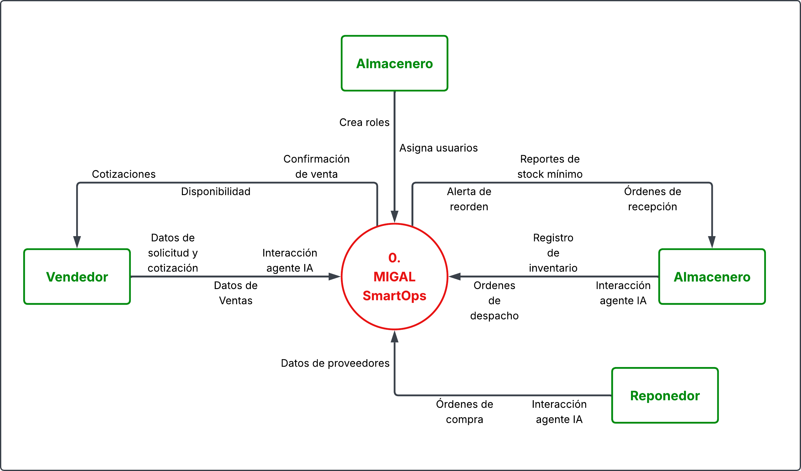
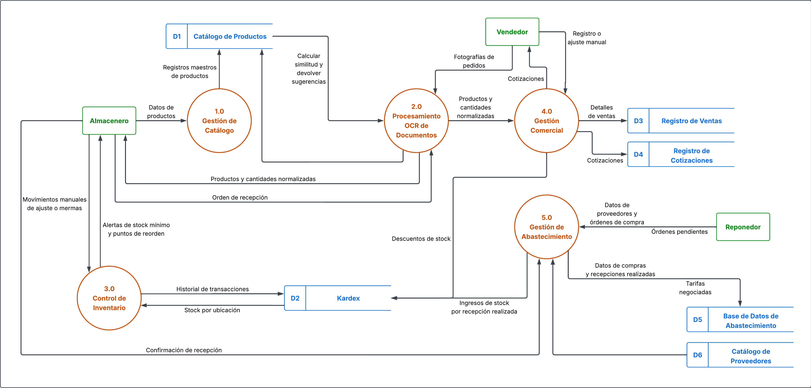

# Flujo de datos

Este documento presenta los Diagramas de Flujo de Datos (DFD) de MIGAL SmartOps, organizados por nivel.

Los diagramas representan el intercambio de información entre los actores, los procesos del sistema y los almacenes de datos.

## Índice

- [Nivel 0: Diagrama de contexto](#nivel-0)
- [Nivel 1: Descomposición del sistema](#nivel-1)

## Nivel 0: Diagrama de contexto

Presenta MIGAL SmartOps como un único proceso e identifica las entradas y salidas de información que atraviesan la frontera del sistema.

## Nivel 1: Descomposición del sistema

Descompone el proceso general de MIGAL SmartOps en sus principales procesos internos, mostrando los flujos de información entre estos, los actores y los almacenes de datos.

Las entradas y salidas de este nivel deben mantener correspondencia con las representadas en el diagrama de contexto.

## Documentación relacionada

- [Alcance y límites](alcance-y-limites.md).
- [Requerimientos](requerimientos.md).
- [Casos de uso](casos-de-uso.md).
- [Modelo y diccionario de datos](modelo-y-diccionario-datos.md).
- [Arquitectura tecnológica](arquitectura-tecnologica.md).