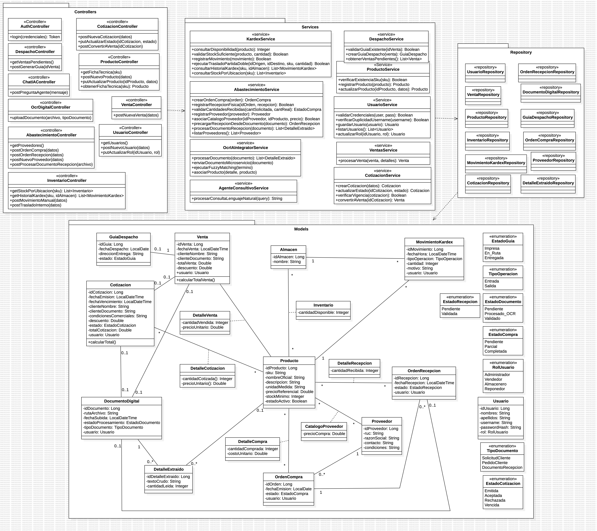

# Modelo y diccionario de clases

Este documento presenta el modelo de clases de MIGAL SmartOps, organizado según las capas de la arquitectura de software propuesta para el sistema.

El modelo identifica las principales clases, sus responsabilidades, atributos, métodos y relaciones, permitiendo representar los procesos de gestión comercial, catálogo de productos, inventario, abastecimiento, recepción de mercadería y despacho.

La actualización incorpora la gestión independiente de clientes y proveedores, el control de existencias físicas y reservadas por almacén, y la atención de ventas que requieren abastecimiento adicional. Asimismo, diferencia el registro comercial de una venta de los movimientos físicos de Kardex, conservando la trazabilidad de las operaciones.

El modelo incorpora además la clasificación jerárquica de productos con su indicador de aprobación automática, los códigos de negocio, el rechazo de cotizaciones, la anulación y reimpresión de guías de despacho y las conversaciones del agente de IA. Su correspondencia con el modelo de datos vigente y con los ADR 003, 008 y 009 se mantiene en cada clase.

Las clases se organizan en las capas de presentación, negocio, acceso a datos y dominio, de acuerdo con la arquitectura tecnológica definida para MIGAL SmartOps.

## Índice

- [Diagrama de clases](#diagrama-clases)
- [Capa de presentación](#controllers)
- [Capa de negocio](#services)
- [Capa de acceso a datos](#repositories)
- [Capa de dominio](#models)
- [Clases asociativas](#asociativas)
- [Enumeraciones](#enumeraciones)

## Diagrama de clases (UML)

El diagrama de clases representa la estructura del sistema, identificando las principales entidades del dominio, sus atributos y relaciones, así como los componentes responsables de gestionar las operaciones.

Se consideran las relaciones entre cotizaciones, ventas, clientes, productos, inventarios, reservas, proveedores, órdenes de compra, recepciones y guías de despacho.

La asociación entre `DetalleVenta`, `ReservaStock` e `Inventario` permite representar las cantidades comprometidas para una venta desde una o varias ubicaciones físicas. De esta manera, las reservas se administran independientemente de las existencias físicas, que únicamente se modifican mediante movimientos confirmados de Kardex.

Las multiplicidades del diagrama deberán mantener correspondencia con las relaciones definidas en el modelo entidad-relación. Los atributos derivados, como la cantidad libre o la cantidad pendiente de abastecimiento, podrán calcularse mediante operaciones del sistema sin almacenarse como datos independientes.

## Capa de presentación (Controllers)

Encargada de exponer los endpoints de la API REST, recibir las peticiones HTTP provenientes del frontend, validar los datos de entrada y delegar su procesamiento a la capa de negocio. No ejecuta directamente las reglas comerciales ni modifica las existencias del inventario.

| Clase | Responsabilidad principal | Métodos clave |
| --- | --- | --- |
| `AuthController` | Puerta de acceso y autenticación del sistema. | `login(credenciales): Token` |
| `UsuarioController` | Gestión administrativa de usuarios, cuentas, roles y estados de acceso. | `getUsuarios()` `postNuevoUsuario(datos)` `putActualizarRol(idUsuario, rol)` `putActualizarEstado(idUsuario, estado)` |
| `ProductoController` | Recepción de solicitudes relacionadas con el catálogo maestro de productos. | `getFichaTecnica(sku)` `getCategorias()` `postNuevoProducto(datos)` `putActualizarProducto(idProducto, datos)` |
| `ClienteController` | Gestión de clientes registrados y consulta de sus datos comerciales. | `getClientes()` `getCliente(idCliente)` `postNuevoCliente(datos)` `putActualizarCliente(idCliente, datos)` `putActualizarEstado(idCliente, estado)` |
| `InventarioController` | Interfaz para consultar existencias físicas, reservadas y libres, historial de Kardex y operaciones manuales de inventario. | `getStockPorUbicacion(sku): List<Inventario>` `getDisponibilidadGlobal(sku)` `getHistorialKardex([sku], [idAlmacen], [fechas])` `postMovimientoManual(datos)` `postTrasladoInterno(datos)` |
| `VentaController` | Recepción de operaciones relacionadas con ventas aprobadas, cantidades pendientes, reservas y cancelaciones. | `getVentas()` `getDetalleVenta(idVenta)` `getVentasPendientes()` `postNuevaVentaDesdeCotizacion(idCotizacion)` `postRegistrarVentaDirecta(datos)` `postReintentarCobertura(idVenta)` `postCancelarVenta(idVenta, motivo)` |
| `CotizacionController` | Recepción de operaciones de emisión, aceptación, validación y conversión de cotizaciones en ventas. | `postNuevaCotizacion(datos)` `getCotizacion(idCotizacion)` `putActualizarEstado(idCotizacion, estado)` `postRegistrarAceptacion(idCotizacion)` `postValidarViabilidad(idCotizacion)` `postRegistrarRechazo(idCotizacion, datos)` `postConvertirAVenta(idCotizacion)` |
| `DespachoController` | Gestión de ventas pendientes de entrega, programación, emisión de guías, confirmación de salida física, entrega, reimpresiones y anulación. | `getVentasPendientes()` `postEmitirGuia(idVenta)` `postProgramarDespacho(idVenta, fecha)` `postConfirmarSalida(idGuia)` `postRegistrarEntrega(idGuia)` `postRegistrarReimpresion(idGuia, motivo)` |
| `AbastecimientoController` | Puerta de entrada para proveedores, órdenes de compra, recepciones de mercadería y procesamiento documental asociado. | `getProveedores()` `postNuevoProveedor(datos)` `putActualizarProveedor(idProveedor, datos)` `putActualizarEstadoProveedor(idProveedor, estado)` `postOrdenCompra(datos)` `postOrdenRecepcion(datos)` `putActualizarRecepcion(idRecepcion, datos)` `postConfirmarRecepcion(idRecepcion)` `postCerrarOrdenCompra(idOrden)` `postProcesarDocumentoRecepcion(archivo)` |
| `OcrDigitalController` | Interfaz para la carga y procesamiento de documentos mediante OCR y Fuzzy Matching. | `uploadDocumento(archivo, tipoDocumento)` `getResultadoDocumento(idDocumento)` `postValidarExtraccion(idDocumento, correcciones)` `postAsociarDocumento(idDocumento, operacion)` |
| `ChatIAController` | Recepción de mensajes en lenguaje natural dirigidos al Agente Consultivo (`POST /agente/mensajes`, campo `mensaje`) y gestión de las conversaciones propias del usuario. El agente es de solo lectura. | `postPreguntaAgente(mensaje)` `getConversacionesAgente()` `getConversacionAgente(idConversacion)` `deleteConversacionAgente(idConversacion)` `getHerramientasAgente()` |

Los parámetros entre corchetes son opcionales. El registro de una venta se origina siempre en una cotización aceptada y validada. La venta directa desde la interfaz (`postRegistrarVentaDirecta`) crea, en una sola transacción, la cotización, su aceptación y su validación antes de registrar la venta, sin digitación duplicada (ADR-003, decisión 5).

La incorporación de `ClienteController` permite gestionar la entidad Cliente de manera independiente, mientras que las operaciones de proveedores se mantienen dentro de `AbastecimientoController`, evitando duplicar responsabilidades.

## Capa de negocio (Services)

Constituye el núcleo funcional de MIGAL SmartOps. Contiene las reglas de negocio, las validaciones, los cálculos y la coordinación de operaciones entre las entidades del dominio y la capa de persistencia.

Esta capa es responsable de mantener la coherencia de los procesos comerciales y del inventario, aplicando mecanismos transaccionales para evitar reservas duplicadas, movimientos inconsistentes y cantidades físicas negativas.

| Clase | Responsabilidad principal | Lógica de negocio clave |
| --- | --- | --- |
| `UsuarioService` | Validación de credenciales y administración de usuarios y roles. | `validarCredenciales(user, pass): Boolean` `verificarDuplicidadUsername(username): Boolean` `guardarUsuario(usuario): Usuario` `listarUsuarios(): List<Usuario>` `actualizarRol(idUsuario, rol): Usuario` `actualizarEstado(idUsuario, estado): Usuario` |
| `ProductoService` | Mantener la integridad y consistencia del catálogo maestro, incluyendo categorías, precios referenciales y stock mínimo. | `verificarExistenciaSku(sku): Boolean` `registrarProducto(producto): Producto` `actualizarProducto(idProducto, datos): Producto` `obtenerFichaTecnica(sku): Producto` `validarCategoriaProducto(categoria): Boolean` |
| `ClienteService` | Registrar, consultar, actualizar y desactivar clientes, conservando sus asociaciones comerciales. | `registrarCliente(cliente): Cliente` `buscarCliente(identificador): Cliente` `listarClientes(): List<Cliente>` `actualizarCliente(idCliente, datos): Cliente` `actualizarEstado(idCliente, estado): Cliente` |
| `InventarioService` | Consultar y administrar las existencias físicas, reservadas y libres por producto y almacén, así como las reservas asociadas a ventas. | `consultarStockPorUbicacion(sku): List<Inventario>` `consultarDisponibilidadGlobal(sku): Decimal` `calcularStockLibre(idInventario): Decimal` `reservarDesdeUbicaciones(idDetalleVenta, cantidad): List<ReservaStock>` `consultarReservas(idVenta): List<ReservaStock>` `liberarReservas(idVenta): Boolean` |
| `KardexService` | Registrar y consultar movimientos físicos de inventario, asegurando la integridad de saldos y la trazabilidad por ubicación. | `consultarHistorialKardex([sku], [idAlmacen], [fechas]): List<MovimientoKardex>` `registrarMovimiento(movimiento): Boolean` `registrarEntradaPorRecepcion(idRecepcion): Boolean` `registrarSalidaPorGuia(idGuia): Boolean` `ejecutarTrasladoPartidaDoble(idOrigen, idDestino, sku, cantidad): Boolean` `registrarAjusteInventario(datos): Boolean` |
| `VentaService` | Registrar ventas originadas en cotizaciones aprobadas, coordinar reservas, administrar faltantes y gestionar cancelaciones autorizadas. | `registrarVentaDesdeCotizacion(idCotizacion): Venta` `calcularCantidadesPendientes(idVenta)` `consultarVentasPendientes(): List<Venta>` `actualizarEstadoVenta(idVenta, estado): Venta` `registrarVentaDirecta(datos): Venta` `reintentarCobertura(idVenta): Venta` `cancelarVentaAntesDespacho(idVenta, motivo): Venta` |
| `CotizacionService` | Gestionar el ciclo de vida de cotizaciones, su aceptación, evaluación de viabilidad comercial y conversión única en venta. | `crearCotizacion(datos): Cotizacion` `actualizarEstado(idCotizacion, estado): Cotizacion` `verificarVigencia(cotizacion): Boolean` `registrarAceptacion(idCotizacion): Cotizacion` `validarViabilidadAbastecimiento(idCotizacion): Boolean` `registrarRechazo(idCotizacion, origen, motivo): Cotizacion` `convertirAVenta(idCotizacion): Venta` |
| `DespachoService` | Gestionar las guías de despacho, verificar la disponibilidad completa de los productos comprometidos y confirmar su salida física. | `obtenerVentasPendientes(): List<Venta>` `validarGuiaExistente(idVenta): Boolean` `validarCoberturaCompleta(idVenta): Boolean` `crearGuiaDespacho(venta): GuiaDespacho` `programarDespacho(idVenta, fecha): GuiaDespacho` `confirmarSalidaCompleta(idGuia): Boolean` `registrarEntrega(idGuia): GuiaDespacho` `registrarReimpresion(idGuia, motivo): ReimpresionGuia` `anularGuia(idGuia): GuiaDespacho` |
| `AbastecimientoService` | Gestionar proveedores, órdenes de compra, recepciones completas o parciales de proveedores y necesidades pendientes de abastecimiento. | `crearOrdenCompra(orden): OrdenCompra` `registrarRecepcionFisica(idOrden, recepcion): OrdenRecepcion` `confirmarRecepcion(idRecepcion): Boolean` `validarCantidadesRecibidas(cantSolicitada, cantReal): EstadoCompra` `registrarProveedor(proveedor): Proveedor` `actualizarProveedor(idProveedor, datos): Proveedor` `desactivarProveedor(idProveedor): Proveedor` `listarProveedores(): List<Proveedor>` `validarProveedorActivo(idProveedor): Boolean` `asociarCatalogoProveedor(idProveedor, idProducto, precio): Boolean` `procesarDocumentoRecepcion(documento): List<DetalleExtraido>` `cerrarOrdenCompra(idOrden): OrdenCompra` |
| `OcrIAIntegratorService` | Comunicación con el microservicio Python y normalización de información extraída mediante OCR y Fuzzy Matching. | `procesarDocumento(documento): List<DetalleExtraido>` `enviarDocumentoMicroservicio(documento)` `ejecutarFuzzyMatching(termino)` `asociarProducto(detalle, producto)` `validarDatosExtraidos(documento, correcciones)` |
| `AgenteConsultivoService` | Interpretación de mensajes en lenguaje natural, coordinación del Tool Calling autorizado (solo lectura) y gestión de las conversaciones del usuario. | `procesarConsultaLenguajeNatural(mensaje): String` `validarPermisosConsulta(idUsuario, herramienta): Boolean` `listarConversaciones(idUsuario): List<ConversacionAgente>` `eliminarConversacion(idConversacion, idUsuario): Boolean` |

### Consideraciones de consistencia

**Cotizaciones y ventas.** La emisión o aceptación de una cotización no implica el registro automático de una venta. La conversión requiere la validación de viabilidad por MIGAL y solo puede realizarse una vez por cotización aprobada.

**Abastecimiento con stock insuficiente.** La viabilidad se determina según el indicador `aprobacionAutomatica` de la categoría efectiva del producto. Las categorías con dicho indicador verdadero son Cemento y aglomerantes, Agregados, Ladrillos y bloques y Fierro y acero de construcción, es decir, las categorías de cemento, ladrillos, fierros y agregados, cuya viabilidad se aprueba automáticamente. En las demás categorías, la decisión dependerá de la evaluación de la propietaria responsable, considerando las condiciones y plazos de atención. Si los productos de una venta directa combinan categorías de aprobación automática y manual, la operación exige el rol Administrador (ADR-009, decisión 8).

**Inventario y reservas.** `InventarioService` gestiona la asignación de existencias a cada venta, mientras que `KardexService` registra las entradas y salidas físicas. Una reserva no modifica las existencias físicas ni genera movimientos de Kardex.

**Recepciones.** El registro de una orden de compra no modifica el inventario. El registro de una recepción la deja en estado pendiente, sin movimientos. Su validación, en una sola transacción, genera los movimientos de entrada por las cantidades efectivamente recibidas y actualiza el estado de la orden de compra.

**Despacho.** La generación o impresión de una guía no produce una salida de Kardex. Los movimientos de salida se registran cuando se confirma que la mercadería completa abandona físicamente el almacén.

**Cancelaciones.** La cancelación autorizada antes del despacho debe liberar las reservas asociadas, registrar el motivo y conservar la evidencia del usuario que autorizó la operación, sin generar movimientos físicos inexistentes. Si la venta se encuentra en lista para despacho, la guía emitida pasa a anulada, sin movimientos de Kardex.

Las operaciones que afecten existencias y reservas deberán realizarse de forma transaccional para evitar inconsistencias ante accesos concurrentes o fallas durante su procesamiento.

## Capa de acceso a datos (Repositories)

Actúa como la capa de persistencia del sistema mediante interfaces que permiten consultar, registrar y actualizar la información almacenada en PostgreSQL.

Los repositorios proporcionan operaciones de acceso a datos a los servicios, sin implementar directamente las reglas comerciales o de inventario.

| Clase / Interfaz | Responsabilidad principal |
| --- | --- |
| `UsuarioRepository` | Persistencia y consulta de usuarios, credenciales, roles y estados de acceso. |
| `ProductoRepository` | Persistencia y consulta del catálogo maestro de productos. |
| `ClienteRepository` | Persistencia, consulta, actualización y desactivación de clientes. |
| `InventarioRepository` | Acceso a existencias físicas por producto y almacén, incluyendo consultas y bloqueos transaccionales para reservas. |
| `ReservaStockRepository` | Persistencia y consulta de las reservas asociadas a detalles de venta e inventarios específicos. |
| `MovimientoKardexRepository` | Persistencia y consulta del historial de movimientos físicos de inventario. |
| `VentaRepository` | Persistencia y consulta de ventas, sus estados y detalles comerciales. |
| `CotizacionRepository` | Persistencia y consulta de cotizaciones, estados y datos comerciales. |
| `GuiaDespachoRepository` | Persistencia y consulta de guías, programación y confirmación de salidas físicas. |
| `OrdenCompraRepository` | Persistencia y consulta de órdenes de compra asociadas a proveedores. |
| `OrdenRecepcionRepository` | Persistencia y consulta de recepciones asociadas a órdenes de compra. |
| `DocumentoDigitalRepository` | Persistencia y consulta de documentos cargados para procesamiento OCR. |
| `DetalleExtraidoRepository` | Persistencia de elementos extraídos mediante OCR, incluidos aquellos pendientes de asociación con un producto. |
| `ProveedorRepository` | Persistencia, consulta, actualización, activación y desactivación de proveedores. |
| `CategoriaRepository` | Persistencia y consulta de la jerarquía de categorías de productos. |
| `ReimpresionGuiaRepository` | Persistencia de solo anexión de las reimpresiones de guías de despacho. |
| `ConversacionAgenteRepository` | Persistencia y consulta de las conversaciones y mensajes del agente de cada usuario. |

Las clases asociativas de detalle y catálogo podrán gestionarse mediante los repositorios de sus entidades principales, manteniendo las restricciones de integridad definidas en el modelo de datos.

La incorporación de `ReservaStockRepository` permitirá consultar las reservas activas de cada inventario y conservar el historial de aquellas que hayan sido liberadas o consumidas.

## Capa de dominio (Models)

Contiene las clases que representan las entidades y conceptos principales de MIGAL SmartOps. Estas clases mantienen la información necesaria para describir las operaciones y sus relaciones, pudiendo implementarse como entidades JPA en el backend Java.

Los atributos se expresan mediante nomenclatura camelCase. Los identificadores y claves foráneas correspondientes se detallan en el modelo entidad-relación y en el diccionario de datos.

| Clase | Responsabilidad principal | Elementos principales |
| --- | --- | --- |
| `Usuario` | Representar a los colaboradores autenticados, sus roles y el estado de acceso al sistema. | `idUsuario` `nombres` `apellidos` `username` `passwordHash` `rol` `estadoActivo` `fechaRegistro` `fechaActualizacion` |
| `Cliente` | Representar a la persona o entidad asociada a una cotización o venta, conservando su identificación e historial comercial. | `idCliente` `codigo` `tipoDocumento` `numeroDocumento` `nombreRazonSocial` `telefonoContacto` `direccionReferencia` `estadoActivo` `fechaRegistro` `activar()` `desactivar()` |
| `Almacen` | Representar cada ubicación física donde se mantienen existencias de productos. | `idAlmacen` `nombre` `tipoUbicacion` `direccionReferencia` `estadoActivo` |
| `Categoria` | Representar la clasificación jerárquica de dos niveles de los productos y el indicador que determina la viabilidad automática de abastecimiento de sus productos. | `idCategoria` `nombre` `idCategoriaPadre` `aprobacionAutomatica` `estadoActivo` |
| `Producto` | Representar los artículos del catálogo maestro y sus características comerciales. | `idProducto` `sku` `nombreOficial` `descripcion` `unidadMedida` `precioReferencial` `stockMinimo` `estadoActivo` `idCategoria` `marca` `presentacion` `fechaRegistro` `fechaActualizacion` |
| `Venta` | Representar el pedido comercial aprobado, sus importes y el estado de abastecimiento o despacho. | `idVenta` `codigo` `idCotizacion` `idCliente` `idUsuarioResponsable` `fechaVenta` `descuento` `totalVenta` `estado` `fechaCancelacion` `motivoCancelacion` `idUsuarioAutorizante` `calcularTotalVenta()` `calcularPendiente()` |
| `Cotizacion` | Representar la propuesta comercial presentada al cliente, su aceptación y la validación de viabilidad por MIGAL. | `idCotizacion` `codigo` `idCliente` `idUsuarioResponsable` `fechaEmision` `fechaVencimiento` `condicionesComerciales` `descuento` `totalCotizacion` `estado` `fechaAceptacionCliente` `fechaValidacionMigal` `origenRechazo` `idUsuarioRechazo` `fechaRechazo` `motivoRechazo` `calcularTotal()` `verificarVigencia()` |
| `GuiaDespacho` | Representar el documento utilizado para controlar la preparación y salida física completa de una venta. | `idGuia` `codigo` `idVenta` `direccionEntrega` `fechaDespacho` `estado` `fechaEmision` `fechaSalidaReal` `fechaEntrega` `idUsuarioResponsable` |
| `ReimpresionGuia` | Representar cada impresión adicional de una guía de despacho, con su motivo obligatorio. | `idReimpresion` `idGuia` `idUsuario` `fechaReimpresion` `motivo` |
| `MovimientoKardex` | Representar cada entrada o salida física que afecta las existencias de un producto en una ubicación determinada. | `idMovimiento` `idInventario` `tipoOperacion` `cantidad` `fechaHora` `motivo` `idUsuarioResponsable` `origenMovimiento` `idGuia` `idRecepcion` `referenciaTraslado` `idMovimientoCorregido` |
| `OrdenCompra` | Representar una compra acordada con un proveedor, sin modificar directamente las existencias físicas. | `idOrden` `codigo` `idProveedor` `idUsuarioResponsable` `fechaEmision` `estado` `fechaEntregaEstimada` `observaciones` `modalidadPago` `validarProveedorActivo()` |
| `OrdenRecepcion` | Representar el registro de una recepción física de mercadería asociada a una orden de compra. | `idRecepcion` `codigo` `idOrden` `idUsuarioResponsable` `fechaRecepcion` `estado` `fechaValidacion` `observaciones` |
| `Proveedor` | Representar a un proveedor registrado, sus datos comerciales y su estado de vigencia. | `idProveedor` `ruc` `razonSocial` `contacto` `condiciones` `estadoActivo` `fechaRegistro` `activar()` `desactivar()` |
| `DocumentoDigital` | Representar los archivos operativos cargados al sistema para su procesamiento mediante OCR. | `idDocumento` `rutaArchivo` `nombreArchivo` `tamanoBytes` `fechaSubida` `estadoProcesamiento` `codigoError` `tipoDocumento` `fechaEliminacion` `idUsuario` `idCotizacion` `idRecepcion` |
| `DetalleExtraido` | Representar los elementos obtenidos mediante OCR, conservando el texto original y sus correcciones. | `idDetalleExtraido` `idDocumento` `textoCrudo` `cantidadLeida` `idProducto` `textoCorregido` `skuSugerido` `confianza` `cantidadCorregida` `requiereRevision` `descartado` |
| `ConversacionAgente` | Representar una conversación del usuario con el agente de IA, con sus mensajes en orden cronológico. | `idConversacion` `idUsuario` `titulo` `fechaCreacion` `fechaUltimoMensaje` |
| `MensajeAgente` | Representar cada mensaje de una conversación, del usuario o del agente, con las herramientas invocadas y los registros consultados en la respuesta. | `idMensaje` `idConversacion` `autor` `texto` `fechaHora` `incierta` |

### Consideraciones del modelo de dominio

**Cliente y Proveedor** se mantienen como entidades independientes. Sus relaciones permiten consultar cotizaciones, ventas, compras y recepciones históricas sin duplicar innecesariamente sus datos.

**Venta** representa el pedido aprobado y conserva la relación obligatoria con la cotización que lo originó. No se introduce una clase adicional `Pedido`, debido a que ambos conceptos corresponden a una misma operación comercial en el flujo propuesto.

**Cotizacion** mantiene los datos comerciales y las fechas de aceptación y validación. Sus estados corresponden a los del modelo de datos, y el rechazo registra su origen, usuario, fecha y motivo.

**GuiaDespacho** conserva la relación con una única venta. La fecha programada y la fecha de salida real corresponden a eventos diferentes, por lo que no deben utilizarse indistintamente.

**MovimientoKardex** conserva la trazabilidad de cada movimiento físico mediante su inventario, tipo de operación, cantidad, fecha, usuario responsable y operación de origen. Un movimiento compensatorio referencia al movimiento que corrige mediante `idMovimientoCorregido`.

**Categoria y Producto.** Cada `Producto` pertenece a una única categoría, que puede ser de primer nivel o una subcategoría. La categoría efectiva del producto es la subcategoría asignada; si la categoría asignada no tiene subcategorías, ella es la categoría efectiva. El nombre de una categoría es único dentro de su padre, y una categoría no puede ser su propia categoría padre. La relación se implementa mediante `idCategoria` en `Producto`, y la relación jerárquica entre categorías se expresa mediante `idCategoriaPadre`.

**Cotizacion y rechazo.** El rechazo por el cliente procede desde el estado emitida y lo registra el personal de ventas o el Administrador. El rechazo por MIGAL procede desde el estado aceptada y solo lo registra el Administrador. `origenRechazo` toma los valores `cliente` o `migal`. El motivo es obligatorio y no puede estar vacío. Los atributos de rechazo son nulos en los demás estados, y el rechazo no reserva ni libera existencias.

**Venta y cancelación.** La cancelación antes del despacho registra `motivoCancelacion`, `fechaCancelacion` e `idUsuarioAutorizante`. La venta directa se registra a partir de una cotización que pasa por aceptación y validación en el mismo paso transaccional.

**GuiaDespacho y ReimpresionGuia.** La guía anulada conserva su registro y no puede reactivarse. La salida confirmada y la entrega no admiten anulación. `fechaEntrega` se registra solo cuando la guía está entregada. `ReimpresionGuia` registra cada impresión adicional con su motivo obligatorio; es de solo anexión, no modifica el estado de la guía ni el inventario y no genera movimientos de Kardex.

**Codigo.** Las entidades visibles para el usuario (`Cliente`, `Cotizacion`, `Venta`, `GuiaDespacho`, `OrdenCompra` y `OrdenRecepcion`) disponen del atributo `codigo`. La base de datos lo genera a partir de la clave primaria con un prefijo propio (`CLI-`, `COT-`, `V-`, `D-`, `OC-` y `R-`), por lo que la aplicación no lo escribe. Las rutas de la API y las relaciones entre clases utilizan la clave primaria.

**DocumentoDigital y DetalleExtraido.** La eliminación de un documento es lógica: se registra `fechaEliminacion`, el documento y sus elementos extraídos se excluyen de las consultas habituales y la fila se conserva. `codigoError` solo se informa mientras el documento se encuentra pendiente. La sugerencia de SKU y las coincidencias son propuestas que no modifican `idProducto` hasta la validación humana, y un elemento extraído no repite un producto entre sus coincidencias. Ninguno de estos registros genera ventas, recepciones confirmadas ni movimientos de inventario.

**ConversacionAgente y MensajeAgente.** Una `ConversacionAgente` pertenece a un único usuario, y cada `MensajeAgente` pertenece a una única conversación. Ambas clases se describen según el contrato del módulo del agente de IA. El agente no modifica datos transaccionales, y el usuario solo accede a sus propias conversaciones. Su persistencia aún no figura en el modelo de datos vigente y deberá incorporarse antes de su implementación.

## Clases asociativas de la capa de dominio

Las clases asociativas representan relaciones que contienen información propia y que deben conservarse como registros independientes dentro del modelo.

En particular, las reservas de stock requieren identificar tanto el detalle de venta como el inventario específico desde el cual se comprometen las unidades.

| Clase asociativa | Clases relacionadas | Atributos principales | Responsabilidad |
| --- | --- | --- | --- |
| `Inventario` | Producto + Almacen | `idInventario` `idProducto` `idAlmacen` `cantidadFisica` `cantidadReservada` (derivado) `cantidadLibre` (derivado) | Representar las existencias físicas de cada producto por ubicación y calcular las cantidades reservadas y libres. |
| `ReservaStock` | DetalleVenta + Inventario | `idReserva` `idDetalleVenta` `idInventario` `cantidadReservada` `estado` `fechaReserva` `fechaCierre` `idUsuarioResponsable` | Registrar las unidades asignadas a cada línea de venta desde un inventario específico, conservando su historial de reserva, liberación o consumo. |
| `DetalleVenta` | Venta + Producto | `idDetalleVenta` `idVenta` `idProducto` `cantidadVendida` `precioUnitario` `subtotalDetalle` (derivado) `cantidadReservadaActual` (derivado) `cantidadPendienteAbastecimiento` (derivado) | Representar los productos y cantidades comercialmente comprometidos, así como consultar su cobertura mediante reservas. |
| `DetalleCotizacion` | Cotizacion + Producto | `idCotizacion` `idProducto` `cantidadCotizada` `precioUnitario` `subtotalDetalle` (derivado) | Representar los productos incluidos en una cotización y conservar las cantidades y precios ofrecidos. |
| `DetalleCompra` | OrdenCompra + Producto | `idOrden` `idProducto` `cantidadComprada` `costoUnitario` `subtotalDetalle` (derivado) `cantidadPendienteRecepcion` (derivado) | Registrar los productos solicitados al proveedor y determinar las cantidades pendientes de recepción. |
| `DetalleRecepcion` | OrdenRecepcion + Producto + Almacen | `idRecepcion` `idProducto` `idAlmacenDestino` `cantidadRecibida` | Representar las cantidades físicamente recibidas y la ubicación donde ingresan al inventario. |
| `CatalogoProveedor` | Proveedor + Producto | `idProveedor` `idProducto` `precioCompra` `plazoEntregaReferencialDias` `fechaActualizacionPrecio` | Representar la relación comercial entre proveedores y productos, incluyendo precios y plazos referenciales de abastecimiento. |
| `CoincidenciaDetalle` | DetalleExtraido + Producto | `idCoincidencia` `idDetalleExtraido` `idProducto` `similitud` `posicion` | Representar los productos candidatos que el procesamiento OCR propone para un elemento extraído, con su similitud y su posición en la lista de sugerencias. Son sugerencias que no modifican `idProducto` hasta la validación humana. |

### Reglas de consistencia

- Un producto puede tener registros de inventario en diferentes almacenes, pero una misma combinación de producto y ubicación debe ser única.
- Cada reserva corresponde a un detalle de venta y a un inventario específico, permitiendo asignar unidades de un mismo producto desde varios almacenes.
- La cantidad reservada de un inventario se obtiene de la suma de reservas activas. El stock libre corresponde a las existencias físicas menos las reservas activas.
- La cantidad reservada de una línea de venta no puede superar la cantidad comercialmente comprometida.
- Una reserva no origina movimientos de salida de Kardex. Estos se generan únicamente al confirmar la salida física correspondiente al despacho.
- Las recepciones de proveedores pueden ser parciales y registrarse en diferentes momentos, manteniendo la relación con la orden de compra original.
- Los atributos derivados se calculan mediante métodos o consultas y no requieren necesariamente columnas adicionales en la base de datos.
- La confirmación de operaciones que afecten existencias deberá preservar la integridad transaccional y evitar registros duplicados.

## Enumeraciones del modelo de dominio

Las enumeraciones permiten representar los estados y categorías utilizados por las clases del dominio, evitando el uso de valores arbitrarios en las operaciones del sistema.

| Enumeración | Valores | Finalidad |
| --- | --- | --- |
| `RolUsuario` | `administrador` `vendedor` `almacenero` `reponedor` | Controlar el nivel de acceso y los permisos de los usuarios internos. |
| `OrigenRechazo` | `cliente` `migal` | Identificar la parte que rechaza una cotización. |
| `TipoOperacion` | `entrada` `salida` | Identificar el sentido de cada movimiento físico de Kardex. |
| `OrigenMovimiento` | `despacho` `recepcion` `ajuste` `traslado` | Identificar la operación que origina un movimiento de inventario. |
| `EstadoReserva` | `activa` `liberada` `consumida` | Representar el ciclo de vida de una reserva de existencias. |
| `EstadoGuia` | `preparacion` `emitida` `salida_confirmada` `entregada` `anulada` | Representar la preparación, emisión, confirmación de salida, entrega o anulación de la guía de despacho. |
| `EstadoCompra` | `pendiente` `parcial` `completada` | Representar el cumplimiento de una orden de compra frente a las recepciones validadas. |
| `EstadoRecepcion` | `pendiente` `validada` | Representar el registro y la validación de una recepción física de mercadería. |
| `EstadoDocumento` | `pendiente` `procesado_ocr` `validado` | Representar el procesamiento y validación de documentos digitales. |
| `TipoDocumento` | `solicitud_cliente` `documento_recepcion` | Identificar la procedencia y finalidad de los archivos operativos procesados mediante OCR. |
| `EstadoCotizacion` | `emitida` `aceptada` `validada` `rechazada` `vencida` | Representar la emisión, aceptación del cliente, validación comercial, rechazo y vencimiento de cotizaciones. |
| `EstadoVenta` | `pendiente_abastecimiento` `pendiente_despacho` `lista_para_despacho` `despachada` `cancelada` | Representar la situación operativa de una venta desde su aprobación hasta el despacho o cancelación. |
| `AutorMensaje` | `usuario` `agente` | Identificar el autor de cada mensaje de una conversación con el agente de IA. |

Los valores se escriben en minúsculas, con guion bajo y sin acentos, y coinciden con las restricciones CHECK de la base de datos y con los valores del contrato de la API (ADR-008, decisión 2; ADR-009, decisión 1). Las transiciones de los estados de cotización, venta y guía se describen en el modelo de datos.

El modelo no contempla una enumeración `TipoAtencion` con despacho parcial, debido a que el proceso operativo propuesto diferencia la reserva de cantidades disponibles de la entrega física completa al cliente. Esta decisión deberá conciliarse con los requerimientos de PC2 que actualmente contemplan atención parcial.

Las relaciones, multiplicidades y restricciones de persistencia de estas clases se complementan con el documento [Modelo y diccionario de datos](modelo-y-diccionario-datos.md). Su correspondencia con los procesos y servicios se mantiene mediante la [Matriz de trazabilidad](matriz-trazabilidad.md) y la [Arquitectura tecnológica](arquitectura-tecnologica.md).
