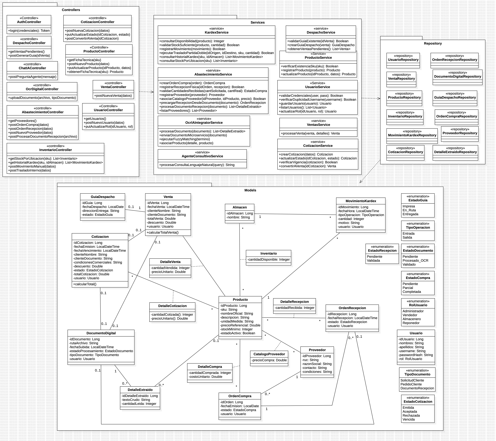

# Modelo y diccionario de clases

## Índice

- [Diagrama de clases](#diagrama-clases)
- [Capa de presentación](#controllers)
- [Capa de negocio](#services)
- [Capa de acceso a datos](#repositories)
- [Capa de dominio](#models)
- [Clases asociativas](#asociativas)
- [Enumeraciones](#enumeraciones)

## Diagrama de clases (UML)

## Capa de presentación (Controllers)

Encargada de exponer los endpoints de la API REST, recibir las peticiones HTTP provenientes del frontend y delegar su procesamiento a la capa de negocio. No contiene lógica de negocio.

| Clase | Responsabilidad principal | Métodos clave |
| --- | --- | --- |
| `AuthController` | Puerta de acceso y autenticación del sistema. | `login(credenciales): Token` |
| `UsuarioController` | Gestión administrativa de usuarios, cuentas y roles. | `getUsuarios()` `postNuevoUsuario(datos)` `putActualizarRol(idUsuario, rol)` |
| `ProductoController` | Recepción de solicitudes relacionadas con el catálogo maestro de productos. | `getFichaTecnica(sku)` `postNuevoProducto(datos)` `putActualizarProducto(idProducto, datos)` |
| `InventarioController` | Interfaz para consultas de stock, historial de Kardex y operaciones manuales de inventario. | `getStockPorUbicacion(sku): List<Inventario>` `getHistorialKardex(sku, idAlmacen): List<MovimientoKardex>` `postMovimientoManual(datos)` `postTrasladoInterno(datos)` |
| `VentaController` | Recepción de las operaciones destinadas al registro de ventas. | `postNuevaVenta(datos)` |
| `CotizacionController` | Recepción de operaciones de creación, actualización y conversión de cotizaciones a clientes. | `postNuevaCotizacion(datos)` `putActualizarEstado(idCotizacion, estado)` `postConvertirAVenta(idCotizacion)` |
| `DespachoController` | Gestión de las ventas pendientes de entrega y generación de documentos de despacho. | `getVentasPendientes()` `postGenerarGuia(idVenta)` |
| `AbastecimientoController` | Puerta de entrada para proveedores, órdenes de compra, recepciones de mercadería y procesamiento documental asociado a recepción. | `getProveedores()` `postOrdenCompra(datos)` `postOrdenRecepcion(datos)` `postNuevoProveedor(datos)` `postProcesarDocumentoRecepcion( archivo)` |
| `OcrDigitalController` | Interfaz genérica para la carga de documentos que serán procesados mediante OCR y Fuzzy Matching. | `uploadDocumento(archivo, tipoDocumento)` |
| `ChatIAController` | Recepción de consultas en lenguaje natural dirigidas al Agente Consultivo. | `postPreguntaAgente(mensaje)` |

## Capa de negocio (Services)

Es el núcleo de la aplicación. Contiene el 100 % de la lógica del negocio, las validaciones, los cálculos matemáticos y la orquestación de operaciones.

| Clase | Responsabilidad principal | Lógica de negocio clave |
| --- | --- | --- |
| `UsuarioService` | Validación de credenciales y administración de usuarios y roles. | `validarCredenciales(user, pass): Boolean` `verificarDuplicidadUsername(username): Boolean` `guardarUsuario(usuario): Usuario` `listarUsuarios(): List<Usuario>` `actualizarRol(idUsuario, rol): Usuario` |
| `ProductoService` | Mantener la integridad y consistencia del catálogo maestro. | `verificarExistenciaSku(sku): Boolean` `registrarProducto(producto): Producto` `actualizarProducto(idProducto, datos): Producto` `obtenerFichaTecnica(sku): Producto` |
| `KardexService` | Motor transaccional del inventario y encargado de asegurar la coherencia del stock entre ubicaciones. | `consultarDisponibilidad(producto): Integer` `consultarStockPorUbicacion(sku): List<Inventario>` `consultarHistorialKardex(sku, idAlmacen): List<MovimientoKardex>` `validarStockSuficiente(producto, cantidad): Boolean` `registrarMovimiento(movimiento): Boolean` `ejecutarTrasladoPartidaDoble(idOrigen, idDestino, sku, cantidad): Boolean` |
| `VentaService` | Procesamiento transaccional de ventas, independientemente de si se originan directamente o desde una cotización aceptada. | `procesarVenta(venta, detalles): Venta` |
| `CotizacionService` | Gestión del ciclo de vida de cotizaciones y de su eventual conversión en venta. | `crearCotizacion(datos): Cotizacion` `actualizarEstado(idCotizacion, estado): Cotizacion` `verificarVigencia(cotizacion): Boolean` `convertirAVenta(idCotizacion): Venta` |
| `DespachoService` | Validación y emisión de documentos asociados a la entrega física de ventas registradas. | `obtenerVentasPendientes(): List<Venta>` `validarGuiaExistente(idVenta): Boolean` `crearGuiaDespacho(venta): GuiaDespacho` |
| `AbastecimientoService` | Gestión de proveedores, órdenes de compra, recepciones parciales o completas y apoyo documental durante la recepción. | `crearOrdenCompra(orden): OrdenCompra` `registrarRecepcionFisica(idOrden, recepcion): Boolean` `validarCantidadesRecibidas(cantSolicitada, cantReal): EstadoCompra` `registrarProveedor(proveedor): Proveedor` `listarProveedores(): List<Proveedor>` `asociarCatalogoProveedor(idProveedor, idProducto, precio): Boolean` `procesarDocumentoRecepcion(documento): List<DetalleExtraido>` `precargarRecepcionDesdeDocumento(documento): OrdenRecepcion` |
| `OcrIAIntegratorService` | Comunicación con el microservicio Python y normalización de información extraída mediante OCR y Fuzzy Matching. | `procesarDocumento(documento): List<DetalleExtraido>` `enviarDocumentoMicroservicio(documento)` `ejecutarFuzzyMatching(termino)` `asociarProducto(detalle, producto)` |
| `AgenteConsultivoService` | Interpretación de consultas en lenguaje natural y coordinación del Tool Calling autorizado. | `procesarConsultaLenguajeNatural(query): String` |

## Capa de acceso a datos (Repositories)

Actúan como interfaces (Data Access Objects). Su única responsabilidad es traducir las sentencias a SQL para interactuar con la base de datos PostgreSQL.

| Clase / Interfaz | Responsabilidad principal |
| --- | --- |
| `UsuarioRepository` | Persistencia y consulta de usuarios y credenciales. |
| `ProductoRepository` | Persistencia y consulta del catálogo maestro de productos. |
| `InventarioRepository` | Acceso a la información de existencias de productos por ubicación. |
| `MovimientoKardexRepository` | Persistencia y consulta del historial de movimientos del Kardex. |
| `VentaRepository` | Persistencia y consulta de ventas registradas. |
| `CotizacionRepository` | Persistencia y consulta de cotizaciones y sus estados. |
| `GuiaDespachoRepository` | Persistencia y consulta de documentos de despacho asociados a ventas. |
| `OrdenCompraRepository` | Persistencia y consulta de órdenes de compra. |
| `OrdenRecepcionRepository` | Persistencia y consulta de recepciones asociadas a órdenes de compra. |
| `DocumentoDigitalRepository` | Persistencia y consulta de documentos cargados para procesamiento OCR. |
| `DetalleExtraidoRepository` | Persistencia de los elementos obtenidos mediante OCR, incluyendo aquellos todavía pendientes de asociación con un producto. |
| `ProveedorRepository` | Persistencia y consulta del directorio de proveedores. |

## Capa de dominio (Models)

Son las clases de entidad (JPA Entities). Representan la estructura de información en la memoria RAM.

| Clase | Responsabilidad principal | Elementos principales |
| --- | --- | --- |
| `Usuario` | Representar a los colaboradores autenticados del sistema. | `idUsuario` `nombres` `apellidos` `username` `passwordHash` `rol` |
| `Almacen` | Representar cada ubicación física donde se mantienen existencias. | `idAlmacen` `nombre` |
| `Producto` | Representar los artículos del catálogo maestro. | `idProducto` `sku` `nombreOficial` `descripcion` `unidadMedida` `precioReferencial` `stockMinimo` `estadoActivo` |
| `Venta` | Representar una operación comercial confirmada que produce salida de inventario. | `idVenta` `fechaVenta` `clienteNombre` `clienteDocumento` `totalVenta` `descuento` `usuario` `calcularTotalVenta()` |
| `Cotizacion` | Representar una propuesta comercial dirigida a un cliente antes de concretar una venta. | `idCotizacion` `fechaEmision` `fechaVencimiento` `clienteNombre` `clienteDocumento` `condicionesComerciales` `descuento` `estado` `totalCotizacion` `usuario` `calcularTotal()` |
| `GuiaDespacho` | Representar el documento utilizado para controlar la entrega física correspondiente a una venta. | `idGuia` `fechaDespacho` `direccionEntrega` `estado` |
| `MovimientoKardex` | Representar cada entrada o salida que afecta físicamente las existencias. | `idMovimiento` `fechaHora` `tipoOperacion` `cantidad` `motivo` `usuario` |
| `OrdenCompra` | Representar una compra previamente acordada con un proveedor. | `idOrden` `fechaEmision` `estado` `usuario` |
| `OrdenRecepcion` | Representar cada recepción física correspondiente a una Orden de Compra. | `idRecepcion` `fechaRecepcion` `estado` `usuario` |
| `Proveedor` | Representar los proveedores registrados y utilizados durante el abastecimiento. | `idProveedor` `ruc` `razonSocial` `contacto` `condiciones` |
| `DocumentoDigital` | Representar los archivos operativos cargados para procesamiento OCR. | `idDocumento` `rutaArchivo` `fechaSubida` `estadoProcesamiento` `tipoDocumento` `usuario` |
| `DetalleExtraido` | Representar cada elemento textual o cantidad identificada dentro de un DocumentoDigital, aun cuando todavía no posea producto asociado. | `idDetalleExtraido` `textoCrudo` `cantidadLeida` |

## Clases asociativas de la capa de dominio

| Clase asociativa | Clases relacionadas | Responsabilidad |
| --- | --- | --- |
| `Inventario` | Producto + Almacen | Representar las existencias disponibles de cada producto en cada ubicación. Contiene cantidadDisponible. |
| `DetalleVenta` | Venta + Producto | Representar los productos incluidos en una venta, conservando cantidadVendida y precioUnitario. |
| `DetalleCotizacion` | Cotizacion + Producto | Representar los productos incluidos en una cotización, conservando cantidadCotizada y precioUnitario. |
| `DetalleCompra` | OrdenCompra + Producto | Representar los productos solicitados en una Orden de Compra mediante cantidadComprada y costoUnitario. |
| `DetalleRecepcion` | OrdenRecepcion + Producto | Representar las cantidades efectivamente recibidas de cada producto mediante cantidadRecibida. |
| `CatalogoProveedor` | Proveedor + Producto | Representar la asociación comercial entre proveedores y productos, incluyendo precioCompra. |

## Enumeraciones del modelo de dominio

| Enumeración | Valores | Finalidad |
| --- | --- | --- |
| `RolUsuario` | `Administrador` `Vendedor` `Almacenero` `Reponedor` | Controlar el nivel de acceso y permisos de los usuarios internos. |
| `TipoOperacion` | `Entrada` `Salida` | Identificar el sentido de cada movimiento de Kardex. |
| `EstadoGuia` | `Impresa` `En_Ruta` `Entregada` | Representar el ciclo operativo de una guía de despacho. |
| `EstadoCompra` | `Pendiente` `Parcial` `Completada` | Representar el grado de cumplimiento de una Orden de Compra. |
| `EstadoRecepcion` | `Pendiente` `Validada` | Representar el estado de validación de una recepción física. |
| `EstadoDocumento` | `Pendiente` `Procesado_OCR` `Validado` | Representar el estado del procesamiento de un DocumentoDigital. |
| `TipoDocumento` | `SolicitudCliente` `PedidoCliente` `DocumentoRecepcion` | Identificar el contexto operativo del documento cargado al módulo OCR. |
| `EstadoCotizacion` | `Emitida` `Aceptada` `Rechazada` `Vencida` | Representar el ciclo de vida comercial de una cotización. |
