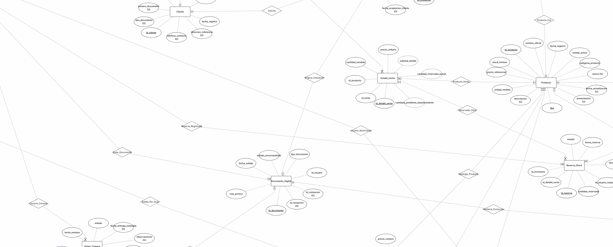

# Modelo y diccionario de datos

El modelo y diccionario de datos de MIGAL SmartOps describe las entidades, atributos, relaciones y restricciones necesarias para almacenar y mantener la información de los procesos comerciales y operativos de la ferretería.

El diseño considera la gestión de productos, clientes, proveedores, cotizaciones, ventas, inventarios por ubicación, reservas de stock, abastecimiento, recepciones de mercadería, movimientos de Kardex y despachos. Asimismo, incluye las entidades necesarias para conservar la información obtenida mediante el procesamiento OCR de documentos.

El modelo se encuentra alineado con las clases del dominio y la arquitectura tecnológica propuesta, utilizando PostgreSQL como sistema gestor de base de datos relacional.

## Índice

- [Diagrama entidad-relación](#diagrama-entidad-relacion)
- [Entidades maestras y transaccionales](#entidades-maestras-y-transaccionales)
- [Relaciones con atributos](#relaciones-con-atributos)
- [Regla de consistencia en cantidades](#regla-consistencia-cantidades)
- [Relaciones sin atributos](#relaciones-sin-atributos)
- [Restricción de exclusividad documental](#exclusividad-documental)

<a id="diagrama-entidad-relacion"></a>

## Diagrama entidad-relación

El diagrama entidad-relación representa la organización lógica de la información de MIGAL SmartOps mediante entidades, atributos, claves y relaciones.

Se incorpora la separación entre operaciones comerciales y movimientos físicos del inventario. Las ventas conservan las cantidades comprometidas, las reservas identifican las existencias asignadas a cada venta por ubicación y los movimientos de Kardex registran las entradas y salidas físicas confirmadas.



Las entidades y relaciones descritas a continuación constituyen la estructura propuesta del modelo. El diagrama deberá actualizarse para reflejar las modificaciones incorporadas en este documento, especialmente las asociaciones correspondientes a reservas, cotizaciones, ventas y despachos.

<a id="entidades-maestras-y-transaccionales"></a>

## Entidades maestras y transaccionales

Las entidades maestras almacenan información de referencia utilizada en diferentes operaciones del sistema. Las entidades transaccionales conservan los registros asociados a las actividades comerciales, de inventario, abastecimiento y procesamiento documental.

Los nombres de atributos utilizan la convención `snake_case`, manteniendo correspondencia con los atributos `camelCase` definidos en el modelo de clases.

### Usuario

| Atributo | Tipo de atributo | Descripción |
| --- | --- | --- |
| `id_usuario` | Único (PK) | Identificador interno del colaborador. |
| `nombres` | Simple | Nombres del usuario. |
| `apellidos` | Simple | Apellidos del usuario. |
| `username` | Único | Nombre de usuario utilizado para el inicio de sesión. |
| `password_hash` | Simple | Contraseña almacenada mediante una representación hash segura. |
| `rol` | Simple | Nivel de acceso: Administrador, Vendedor, Almacenero o Reponedor. |
| `estado_activo` | Simple | Indicador que determina si el usuario puede acceder al sistema. |
| `fecha_registro` | Simple | Fecha y hora de creación de la cuenta. |
| `fecha_actualizacion` | Opcional | Fecha y hora de la última modificación administrativa. |

La desactivación de un usuario no elimina su participación histórica en las operaciones registradas.

### Cliente

| Atributo | Tipo de atributo | Descripción |
| --- | --- | --- |
| `id_cliente` | Único (PK) | Identificador interno del cliente. |
| `tipo_documento` | Opcional | Tipo de documento de identificación, como DNI o RUC. |
| `numero_documento` | Opcional | Número de documento utilizado como referencia comercial. |
| `nombre_razon_social` | Simple | Nombre completo o razón social del cliente. |
| `telefono_contacto` | Opcional | Número telefónico u otro contacto registrado. |
| `direccion_referencia` | Opcional | Dirección habitual o referencia del cliente, distinta de la dirección de despacho cuando corresponda. |
| `estado_activo` | Simple | Indicador de vigencia del registro del cliente. |
| `fecha_registro` | Simple | Fecha y hora de incorporación del cliente. |

El modelo propuesto establece que toda cotización y venta se encuentra asociada a un cliente identificado. La obligatoriedad de esta relación deberá conciliarse con los requisitos actuales que permiten registrar operaciones sin cliente asociado.

### Almacen

| Atributo | Tipo de atributo | Descripción |
| --- | --- | --- |
| `id_almacen` | Único (PK) | Identificador interno de la ubicación física. |
| `nombre` | Simple | Nombre descriptivo de la tienda o almacén. |
| `tipo_ubicacion` | Simple | Clasificación de la ubicación dentro de la infraestructura de MIGAL. |
| `direccion_referencia` | Opcional | Dirección o referencia física de la ubicación. |
| `estado_activo` | Simple | Indicador de disponibilidad de la ubicación para operaciones de inventario. |

El modelo permite diferenciar las existencias mantenidas en la tienda principal y en los dos almacenes adicionales de MIGAL.

### Producto

| Atributo | Tipo de atributo | Descripción |
| --- | --- | --- |
| `id_producto` | Único (PK) | Identificador interno del producto en el catálogo maestro. |
| `sku` | Único | Código oficial y estandarizado del producto. |
| `nombre_oficial` | Simple | Denominación utilizada dentro del catálogo maestro. |
| `descripcion` | Opcional | Características y especificaciones adicionales del producto. |
| `unidad_medida` | Simple | Unidad de manejo, como bolsa, unidad, kilogramo o metro. |
| `precio_referencial` | Simple | Precio comercial de referencia utilizado como apoyo en cotizaciones y ventas. |
| `stock_minimo` | Simple | Umbral utilizado para generar alertas de reposición. |
| `estado_activo` | Simple | Indicador de vigencia del producto. |
| `categoria_producto` | Simple | Categoría comercial utilizada, entre otras funciones, para evaluar la viabilidad del abastecimiento. |
| `marca` | Opcional | Marca comercial del producto. |
| `presentacion` | Opcional | Presentación o formato de comercialización. |
| `fecha_registro` | Simple | Fecha de incorporación al catálogo. |
| `fecha_actualizacion` | Opcional | Fecha de la última modificación. |

El nivel mínimo de stock constituye un umbral de alerta y no una cantidad protegida que impida reservar existencias disponibles.

### Venta

| Atributo | Tipo de atributo | Descripción |
| --- | --- | --- |
| `id_venta` | Único (PK) | Identificador interno de la venta aprobada. |
| `id_cotizacion` | Obligatorio (FK, único) | Referencia a la cotización aceptada y validada que origina la venta. |
| `id_cliente` | Obligatorio (FK) | Referencia al cliente asociado a la venta. |
| `id_usuario_responsable` | Obligatorio (FK) | Usuario responsable del registro comercial. |
| `fecha_venta` | Simple | Fecha y hora de aprobación y registro de la venta. |
| `descuento` | Simple | Descuento monetario general aplicado a la operación. |
| `total_venta` | Derivado | Importe calculado a partir de los detalles y descuentos correspondientes. |
| `estado` | Simple | Situación operativa: pendiente de abastecimiento, pendiente de despacho, lista para despacho, despachada o cancelada. |
| `fecha_cancelacion` | Opcional | Fecha y hora de cancelación, cuando corresponda. |
| `motivo_cancelacion` | Condicional | Justificación obligatoria cuando la venta es cancelada. |

La entidad `Venta` representa el pedido comercial aprobado y conserva su relación con la cotización de origen. No se incorpora una entidad `Pedido` independiente.

El registro de la venta puede producirse aunque no exista stock suficiente, siempre que la operación haya sido aceptada por el cliente y validada comercialmente por MIGAL.

La cantidad comprometida se conserva en los detalles de venta. Las existencias disponibles se reservan según la ubicación, mientras que las cantidades faltantes quedan pendientes de abastecimiento.

El registro comercial no genera movimientos físicos de salida de Kardex.

### Cotizacion

| Atributo | Tipo de atributo | Descripción |
| --- | --- | --- |
| `id_cotizacion` | Único (PK) | Identificador interno de la cotización. |
| `id_cliente` | Obligatorio (FK) | Referencia al cliente destinatario de la propuesta comercial. |
| `id_usuario_responsable` | Obligatorio (FK) | Usuario responsable de elaborar la cotización. |
| `fecha_emision` | Simple | Fecha y hora de emisión. |
| `fecha_vencimiento` | Simple | Fecha límite de vigencia de la propuesta. |
| `condiciones_comerciales` | Opcional | Condiciones de precio, atención y otros términos comerciales aplicables. |
| `descuento` | Simple | Descuento monetario general aplicado a la cotización. |
| `estado` | Simple | Estado comercial de la cotización, considerando emisión, aceptación, validación, rechazo o vencimiento. |
| `total_cotizacion` | Derivado | Importe calculado a partir de los productos, cantidades, precios y descuentos. |
| `fecha_aceptacion_cliente` | Opcional | Fecha y hora en que se registra la aceptación del cliente. |
| `fecha_validacion_migal` | Opcional | Fecha y hora de validación de viabilidad por MIGAL. |

La conversión de una cotización a venta requiere la aceptación del cliente y la validación de viabilidad comercial.

Cuando exista stock insuficiente, la evaluación de abastecimiento considera la categoría del producto. Para cementos, ladrillos, fierros y agregados se contempla una viabilidad de reposición automática; las demás categorías requieren evaluación de la propietaria responsable.

Los nombres y transiciones definitivos de los estados deberán armonizarse con las especificaciones funcionales correspondientes.

### Guia_Despacho

| Atributo | Tipo de atributo | Descripción |
| --- | --- | --- |
| `id_guia` | Único (PK) | Identificador interno de la guía u orden de despacho. |
| `id_venta` | Obligatorio (FK, único) | Referencia a la venta que origina el despacho. |
| `direccion_entrega` | Simple | Dirección o ubicación de destino de la mercadería. |
| `fecha_despacho` | Opcional | Fecha programada para la salida o entrega. |
| `estado` | Simple | Situación del documento: preparación, emitida, salida confirmada o entregada. |
| `fecha_emision` | Simple | Fecha y hora de generación de la guía. |
| `fecha_salida_real` | Opcional | Fecha y hora en que se confirma la salida física de la mercadería. |
| `id_usuario_responsable` | Opcional (FK) | Usuario que confirma la salida física correspondiente. |

Una venta puede generar como máximo una guía de despacho.

La emisión o impresión de la guía no modifica el inventario. La salida de Kardex se registra cuando se confirma físicamente el despacho completo de la mercadería.

### Orden_Compra

| Atributo | Tipo de atributo | Descripción |
| --- | --- | --- |
| `id_orden` | Único (PK) | Identificador interno de la orden de compra. |
| `id_proveedor` | Obligatorio (FK) | Referencia al proveedor registrado y activo al momento de crear la orden. |
| `id_usuario_responsable` | Obligatorio (FK) | Usuario responsable del registro de la compra. |
| `fecha_emision` | Simple | Fecha y hora de emisión. |
| `estado` | Simple | Estado de cumplimiento: Pendiente, Parcial o Completada. |
| `fecha_entrega_estimada` | Opcional | Fecha referencial de entrega acordada con el proveedor. |
| `observaciones` | Opcional | Información adicional relacionada con la operación. |
| `modalidad_pago` | Opcional | Condición de pago registrada con fines informativos. |

El registro de una orden de compra no incrementa automáticamente las existencias. Las entradas de Kardex se originan cuando el personal responsable confirma la recepción física.

### Orden_Recepcion

| Atributo | Tipo de atributo | Descripción |
| --- | --- | --- |
| `id_recepcion` | Único (PK) | Identificador interno de la recepción. |
| `id_orden` | Obligatorio (FK) | Referencia a la orden de compra de origen. |
| `id_usuario_responsable` | Obligatorio (FK) | Usuario responsable del registro y validación de la recepción. |
| `fecha_recepcion` | Simple | Fecha en que se recibe físicamente la mercadería. |
| `estado` | Simple | Estado de la recepción: Pendiente o Validada. |
| `fecha_validacion` | Opcional | Fecha y hora de confirmación de cantidades recibidas. |
| `observaciones` | Opcional | Diferencias, incidencias u observaciones de recepción. |

Una orden de compra puede relacionarse con varias recepciones cuando el proveedor entrega la mercadería en diferentes oportunidades.

Las cantidades recibidas se registran en `Detalle_Recepcion` y generan movimientos de entrada únicamente cuando se confirma la recepción.

### Movimiento_Kardex

| Atributo | Tipo de atributo | Descripción |
| --- | --- | --- |
| `id_movimiento` | Único (PK) | Identificador interno del movimiento. |
| `id_inventario` | Obligatorio (FK) | Referencia al producto y almacén afectados. |
| `fecha_hora` | Simple | Momento en que se registra el movimiento físico. |
| `tipo_operacion` | Simple | Clasificación del movimiento como Entrada o Salida. |
| `cantidad` | Simple | Cantidad positiva de unidades afectadas. |
| `motivo` | Condicional | Justificación requerida especialmente para ajustes, mermas o traslados. |
| `id_usuario_responsable` | Obligatorio (FK) | Usuario responsable de registrar la operación. |
| `origen_movimiento` | Simple | Origen de la operación: Despacho, Recepcion, Ajuste o Traslado. |
| `id_guia` | Opcional (FK) | Referencia a la guía cuando el movimiento proviene de un despacho. |
| `id_recepcion` | Opcional (FK) | Referencia a la recepción cuando el movimiento corresponde a una entrada de abastecimiento. |
| `referencia_traslado` | Opcional | Identificador compartido por los movimientos de salida y entrada de un traslado interno. |

Los movimientos de Kardex representan variaciones reales del inventario físico.

Cada movimiento se vincula a un inventario específico, evitando registrar separadamente referencias redundantes a producto y almacén cuando ambos ya se encuentran identificados mediante `id_inventario`.

Los movimientos asociados a despachos y recepciones deben conservar la referencia a su operación de origen. Los traslados internos se registran mediante una salida del almacén de origen y una entrada en el almacén de destino, vinculadas por una misma referencia.

### Proveedor

| Atributo | Tipo de atributo | Descripción |
| --- | --- | --- |
| `id_proveedor` | Único (PK) | Identificador interno del proveedor. |
| `ruc` | Único | Registro Único de Contribuyentes del proveedor. |
| `razon_social` | Simple | Razón social del proveedor. |
| `contacto` | Simple | Información de contacto, como teléfono o correo electrónico. |
| `condiciones` | Opcional | Condiciones comerciales generales del proveedor. |
| `estado_activo` | Simple | Indicador que determina si el proveedor puede utilizarse en nuevas compras. |
| `fecha_registro` | Simple | Fecha y hora de incorporación del proveedor. |

La desactivación de un proveedor impide utilizarlo en nuevas órdenes de compra, sin eliminar las relaciones históricas con operaciones anteriores.

### Documento_Digital

| Atributo | Tipo de atributo | Descripción |
| --- | --- | --- |
| `id_documento` | Único (PK) | Identificador interno del documento cargado. |
| `ruta_archivo` | Simple | Ruta o referencia al archivo JPG, PNG o PDF almacenado. |
| `fecha_subida` | Simple | Fecha y hora de carga del documento. |
| `estado_procesamiento` | Simple | Estado de procesamiento: Pendiente, Procesado OCR o Validado. |
| `tipo_documento` | Simple | Clasificación funcional del archivo, como SolicitudCliente o DocumentoRecepcion. |
| `id_usuario` | Obligatorio (FK) | Referencia al usuario que cargó el documento. |
| `id_cotizacion` | Opcional (FK) | Referencia a la cotización para la cual se utiliza el documento como fuente de información. |
| `id_recepcion` | Opcional (FK) | Referencia a la recepción para la cual se utiliza el documento como apoyo documental. |

Un documento digital puede utilizarse como entrada para preparar una cotización o apoyar el registro de una recepción.

La extracción de información no genera automáticamente ventas, recepciones confirmadas ni movimientos físicos de inventario.

### Detalle_Extraido

| Atributo | Tipo de atributo | Descripción |
| --- | --- | --- |
| `id_detalle_extraido` | Único (PK) | Identificador interno del elemento extraído. |
| `id_documento` | Obligatorio (FK) | Referencia al documento del cual se obtuvo la información. |
| `texto_crudo` | Simple | Texto original identificado mediante OCR. |
| `cantidad_leida` | Opcional | Cantidad interpretada durante el procesamiento. |
| `id_producto` | Opcional (FK) | Producto del catálogo maestro asociado al elemento mediante Fuzzy Matching o validación manual. |
| `texto_corregido` | Opcional | Texto modificado o normalizado por el usuario responsable. |

La asociación con `Producto` puede permanecer vacía hasta que exista una coincidencia confiable y se confirme su validez.

El resultado del procesamiento OCR constituye información preliminar que requiere revisión antes de utilizarse en una operación definitiva.

<a id="relaciones-con-atributos"></a>

## Relaciones con atributos

Las relaciones con atributos representan asociaciones entre entidades que requieren almacenar información adicional, como cantidades, precios, estados y ubicaciones.

Estas asociaciones se implementan mediante tablas intermedias, permitiendo representar adecuadamente las relaciones de muchos a muchos y conservar los datos correspondientes a cada operación.

| Relación | Entidades que une | Atributos propios | Cardinalidad |
| --- | --- | --- | --- |
| `Inventario` | Producto + Almacen | `id_inventario` (PK)<br>`id_producto` (FK)<br>`id_almacen` (FK)<br>`cantidad_fisica` (Simple)<br>`cantidad_reservada` (Derivado)<br>`cantidad_libre` (Derivado) | Muchos a muchos resuelta mediante Inventario. Un producto puede encontrarse en múltiples almacenes y cada almacén puede contener distintos productos. Cada combinación producto-almacén es única. |
| `Reserva_Stock` | Detalle_Venta + Inventario | `id_reserva` (PK)<br>`id_detalle_venta` (FK)<br>`id_inventario` (FK)<br>`cantidad_reservada` (Simple)<br>`estado` (Simple)<br>`fecha_reserva` (Simple)<br>`fecha_cierre` (Opcional)<br>`id_usuario_responsable` (FK) | Una línea de venta puede tener múltiples reservas y un inventario puede estar asociado a reservas de diferentes ventas. Cada reserva corresponde a una línea y ubicación determinadas. |
| `Detalle_Venta` | Venta + Producto | `id_detalle_venta` (PK)<br>`id_venta` (FK)<br>`id_producto` (FK)<br>`cantidad_vendida` (Simple)<br>`precio_unitario` (Simple)<br>`subtotal_detalle` (Derivado)<br>`cantidad_reservada_actual` (Derivado)<br>`cantidad_pendiente_abastecimiento` (Derivado) | Muchos a muchos resuelta mediante Detalle_Venta. Una venta contiene uno o varios productos y un producto puede aparecer en distintas ventas. |
| `Detalle_Cotizacion` | Cotizacion + Producto | `id_cotizacion` (PK, FK)<br>`id_producto` (PK, FK)<br>`cantidad_cotizada` (Simple)<br>`precio_unitario` (Simple)<br>`subtotal_detalle` (Derivado) | Muchos a muchos. Una cotización puede incluir varios productos y un producto puede estar presente en diferentes cotizaciones. |
| `Detalle_Compra` | Orden_Compra + Producto | `id_orden` (PK, FK)<br>`id_producto` (PK, FK)<br>`cantidad_comprada` (Simple)<br>`costo_unitario` (Simple)<br>`subtotal_detalle` (Derivado)<br>`cantidad_pendiente_recepcion` (Derivado) | Muchos a muchos. Una orden de compra contiene uno o varios productos y un producto puede ser solicitado en distintas órdenes. |
| `Detalle_Recepcion` | Orden_Recepcion + Producto + Almacen | `id_recepcion` (PK, FK)<br>`id_producto` (PK, FK)<br>`id_almacen_destino` (PK, FK)<br>`cantidad_recibida` (Simple) | Una recepción puede incluir varios productos y distribuir sus cantidades entre diferentes ubicaciones. Un producto puede aparecer en múltiples recepciones. |
| `Catalogo_Proveedor` | Proveedor + Producto | `id_proveedor` (PK, FK)<br>`id_producto` (PK, FK)<br>`precio_compra` (Simple)<br>`plazo_entrega_referencial_dias` (Opcional)<br>`fecha_actualizacion_precio` (Opcional) | Muchos a muchos. Un proveedor puede suministrar diferentes productos y un producto puede encontrarse asociado a varios proveedores. |

### Consideraciones de las relaciones

**Inventario.** La combinación de producto y almacén debe ser única. `cantidad_fisica` representa las unidades existentes, mientras que `cantidad_reservada` y `cantidad_libre` son cantidades calculadas a partir de las reservas activas.

**Reserva_Stock.** Cada registro identifica una cantidad de un producto comprometida para una línea de venta desde una ubicación específica. Se consideran los estados Activa, Liberada y Consumida, conservando el historial de asignaciones.

**Detalle_Venta.** `cantidad_vendida` representa la cantidad comprometida comercialmente. No equivale a la cantidad físicamente despachada. Las cantidades reservadas y pendientes se obtienen a partir de los registros de reservas y del estado operativo de la venta.

**Detalle_Recepcion.** La inclusión de `id_almacen_destino` permite registrar el ingreso de productos a diferentes ubicaciones físicas sin perder la referencia a la recepción de origen.

**Catalogo_Proveedor.** Conserva las asociaciones entre productos y proveedores, junto con información comercial referencial. La selección y evaluación final de condiciones de abastecimiento permanece bajo responsabilidad del personal autorizado de MIGAL.

Los atributos marcados como derivados corresponden a valores calculados y no requieren almacenarse como columnas físicas independientes, salvo que una necesidad técnica posterior justifique su persistencia controlada.

<a id="regla-consistencia-cantidades"></a>

## Regla de consistencia en cantidades

El modelo distingue tres magnitudes principales del inventario: cantidad física, cantidad reservada y cantidad libre.

La cantidad física corresponde a las existencias registradas para un producto en una ubicación determinada.

La cantidad reservada corresponde a la suma de reservas activas asignadas a ese inventario.

La cantidad libre representa las existencias físicas que todavía pueden comprometerse en nuevas ventas.

Las relaciones de cálculo son:

```text
cantidad_reservada = SUM(cantidades de reservas activas)

cantidad_libre = cantidad_fisica - cantidad_reservada
```

Para cada línea de venta:

```text
cantidad_reservada_actual = SUM(reservas activas del detalle)

cantidad_pendiente_abastecimiento =
    cantidad_vendida - cantidad_reservada_actual
```

El cálculo de faltantes se aplica durante la preparación de una venta activa. Una venta despachada o cancelada no debe interpretarse nuevamente como pendiente de abastecimiento debido al cierre de sus reservas.

### Restricciones de cantidades

Se establecen las siguientes reglas:

- La cantidad física de un inventario no puede ser negativa.
- La suma de reservas activas no puede superar la cantidad física correspondiente.
- La cantidad reservada de una línea de venta no puede exceder su cantidad comprometida.
- Las reservas deben corresponder al mismo producto del detalle de venta.
- La creación de reservas no modifica las existencias físicas ni genera movimientos de Kardex.
- El registro de una orden de compra no incrementa el inventario.
- La confirmación de una recepción física genera los movimientos de entrada correspondientes.
- La confirmación de un despacho completo genera los movimientos de salida correspondientes.
- Una venta no puede despacharse mientras existan cantidades sin cobertura suficiente.
- Las operaciones de reserva, recepción, traslado, cancelación y despacho deben mantener integridad transaccional.

### Control de concurrencia

Cuando varias ventas soliciten simultáneamente existencias de un mismo producto, el sistema deberá controlar las operaciones de reserva para evitar comprometer una cantidad superior al stock libre.

Las operaciones que modifiquen el inventario se realizarán mediante transacciones y mecanismos de bloqueo adecuados, verificando las cantidades disponibles antes de confirmar los cambios.

Asimismo, la confirmación de una recepción o despacho deberá impedir que una misma operación genere movimientos duplicados ante solicitudes repetidas.

<a id="relaciones-sin-atributos"></a>

## Relaciones sin atributos

Las relaciones sin atributos representan asociaciones directas entre entidades que no requieren información adicional propia. Se implementan mediante claves foráneas y restricciones de integridad referencial.

| Relación | Entidades que une | Lógica y cardinalidad |
| --- | --- | --- |
| Registra | Usuario + Venta | Un usuario puede registrar múltiples ventas; cada venta corresponde a un usuario responsable. |
| Emite | Usuario + Cotizacion | Un usuario puede emitir múltiples cotizaciones; cada cotización conserva un único responsable de registro. |
| Registra_Movimiento | Usuario + Movimiento_Kardex | Un usuario puede registrar múltiples movimientos; cada movimiento identifica un único responsable. |
| Registra_Compra | Usuario + Orden_Compra | Un usuario puede registrar múltiples órdenes de compra; cada orden conserva un responsable. |
| Registra_Recepcion | Usuario + Orden_Recepcion | Un usuario puede registrar múltiples recepciones; cada recepción conserva un responsable. |
| Solicita_Cotizacion | Cliente + Cotizacion | Un cliente puede tener cero o múltiples cotizaciones; cada cotización corresponde a un único cliente según el diseño propuesto. |
| Realiza_Venta | Cliente + Venta | Un cliente puede tener cero o múltiples ventas; cada venta corresponde a un único cliente según el diseño propuesto. |
| Se_Convierte_En | Cotizacion + Venta | Una cotización aceptada y validada puede originar como máximo una venta. Toda venta debe proceder de una única cotización. |
| Genera | Venta + Guia_Despacho | Una venta puede generar cero o una guía de despacho; toda guía corresponde obligatoriamente a una venta. |
| Afecta | Inventario + Movimiento_Kardex | Un inventario puede registrar múltiples movimientos; cada movimiento afecta a un único inventario identificado por producto y ubicación. |
| Genera_Salida | Guia_Despacho + Movimiento_Kardex | Una guía con salida física confirmada puede originar múltiples movimientos de salida, según los productos y ubicaciones utilizados. Cada movimiento de despacho se vincula a una única guía. |
| Genera_Ingreso | Orden_Recepcion + Movimiento_Kardex | Una recepción validada puede generar múltiples movimientos de entrada. Cada movimiento de recepción se vincula a una única recepción de origen. |
| Tiene_Ordenes | Proveedor + Orden_Compra | Un proveedor puede tener cero o múltiples órdenes de compra; cada orden corresponde a un único proveedor. |
| Deriva_En | Orden_Compra + Orden_Recepcion | Una orden de compra puede originar cero o múltiples recepciones; cada recepción corresponde a una única orden de compra. |
| Sube | Usuario + Documento_Digital | Un usuario puede cargar múltiples documentos; cada documento identifica a un único usuario responsable. |
| Contiene | Documento_Digital + Detalle_Extraido | Un documento puede contener cero o múltiples elementos extraídos; cada detalle pertenece a un único documento. |
| Asociado | Producto + Detalle_Extraido | Un producto puede asociarse a múltiples detalles extraídos; cada detalle puede asociarse opcionalmente a un único producto. |
| Origina_Cotizacion | Documento_Digital + Cotizacion | Un documento puede utilizarse como fuente principal de una cotización; la asociación es opcional en ambos extremos. |
| Apoya_Recepcion | Documento_Digital + Orden_Recepcion | Un documento puede utilizarse para precargar una recepción; la asociación es opcional en ambos extremos. |

### Consideraciones de cardinalidad

La relación entre `Cotizacion` y `Venta` conserva una cardinalidad de uno a cero o uno desde la cotización, debido a que no todas las cotizaciones se convierten en ventas.

La relación entre `Venta` y `Guia_Despacho` también es de uno a cero o uno, puesto que una venta puede encontrarse pendiente de abastecimiento o de despacho.

En las relaciones con `Movimiento_Kardex`, el origen de la operación determina la referencia correspondiente. Los movimientos por recepción y despacho poseen vínculos diferentes de los utilizados para ajustes o traslados internos.

Las relaciones entre `Cliente`, `Cotizacion` y `Venta` deben mantener la coherencia de identificación del cliente. Una venta originada en una cotización conserva el mismo cliente de referencia.

Las asociaciones de reservas y detalles comerciales se encuentran descritas en la sección de relaciones con atributos, por lo que no se duplican como relaciones independientes.

<a id="exclusividad-documental"></a>

## Restricción de exclusividad de Documento_Digital

La entidad `Documento_Digital` permite conservar la relación entre un archivo procesado y la operación para la cual se utiliza como fuente de información.

Un documento puede clasificarse como entrada principal de uno de los siguientes procesos:

- Elaboración de una cotización a partir de una solicitud del cliente.
- Precarga de una recepción de mercadería a partir de documentación del proveedor.

Las relaciones `Origina_Cotizacion` y `Apoya_Recepcion` son mutuamente excluyentes para un mismo documento cuando este se utiliza como documento principal de la operación.

Por ello, se establece que `id_cotizacion` e `id_recepcion` no deben contener simultáneamente referencias válidas dentro de un mismo registro.

Ambos campos pueden permanecer vacíos mientras el archivo se encuentra pendiente de revisión o asociación a una operación definitiva.

No se contempla una relación de origen directo entre `Documento_Digital` y `Venta`, debido a que toda venta debe generarse a partir de una cotización previamente aceptada y validada.

La información extraída mediante OCR y Fuzzy Matching constituye una precarga sujeta a validación humana. Su procesamiento no debe generar automáticamente movimientos de inventario, órdenes de recepción confirmadas ni ventas aprobadas.

## Consideraciones de integridad del modelo

Para mantener la consistencia entre las entidades y los procesos del sistema, se consideran las siguientes restricciones generales:

- Los identificadores principales de las entidades deben ser únicos.
- El SKU de Producto, el username de Usuario y el RUC de Proveedor deben mantener restricciones de unicidad.
- La combinación de producto y almacén en Inventario debe ser única.
- Toda Venta debe encontrarse asociada a una Cotizacion aceptada y validada.
- Una Cotizacion puede originar como máximo una Venta.
- Una Venta puede generar como máximo una Guia_Despacho.
- Las reservas activas no deben superar las existencias físicas de un inventario.
- Los movimientos de Kardex deben identificar el inventario afectado y la operación que los originó.
- Las cancelaciones anteriores al despacho deben liberar las reservas y conservar el motivo y la autorización correspondiente.
- Los registros históricos deben conservarse cuando se desactiven clientes, proveedores, productos o usuarios.
- Los movimientos de inventario y las reservas deben ejecutarse mediante operaciones transaccionales consistentes.

Para la implementación en PostgreSQL se propone utilizar tipos numéricos exactos, como `NUMERIC(14,3)` para cantidades y `NUMERIC(14,2)` para importes. Los registros temporales que requieran trazabilidad podrán utilizar `TIMESTAMPTZ`.

Las reglas de unicidad, claves foráneas, restricciones de cantidad y validaciones de estado deberán aplicarse mediante mecanismos de base de datos y de la capa de negocio, según corresponda.

La autorización de cancelaciones requiere conservar evidencia del usuario autorizante, la fecha, la operación y el motivo. El esquema de auditoría persistente correspondiente deberá precisarse antes de considerar completamente implementada esta responsabilidad.

Finalmente, se mantiene pendiente la conciliación de las reglas de atención parcial y obligatoriedad del cliente con los requerimientos funcionales actualmente documentados. Estas diferencias deberán resolverse para garantizar la consistencia entre el modelo de datos, el modelo de clases, los casos de uso y la matriz de trazabilidad.
